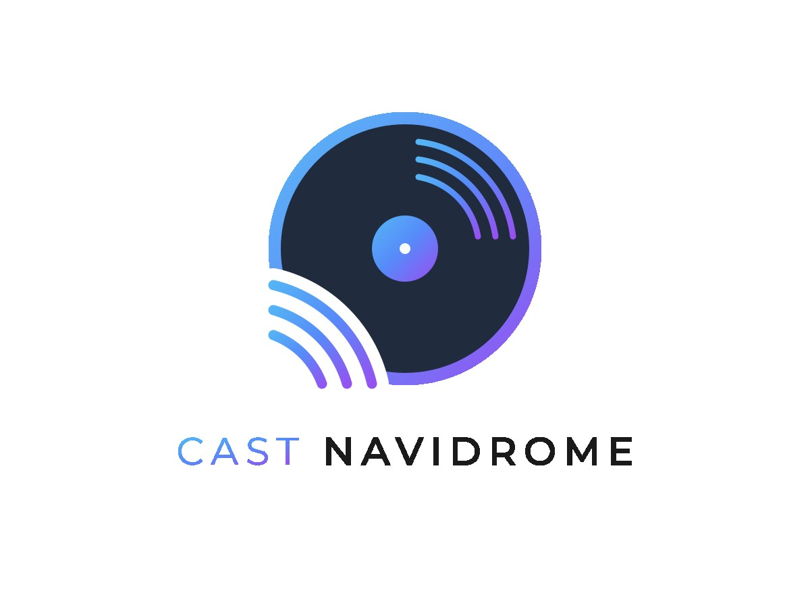
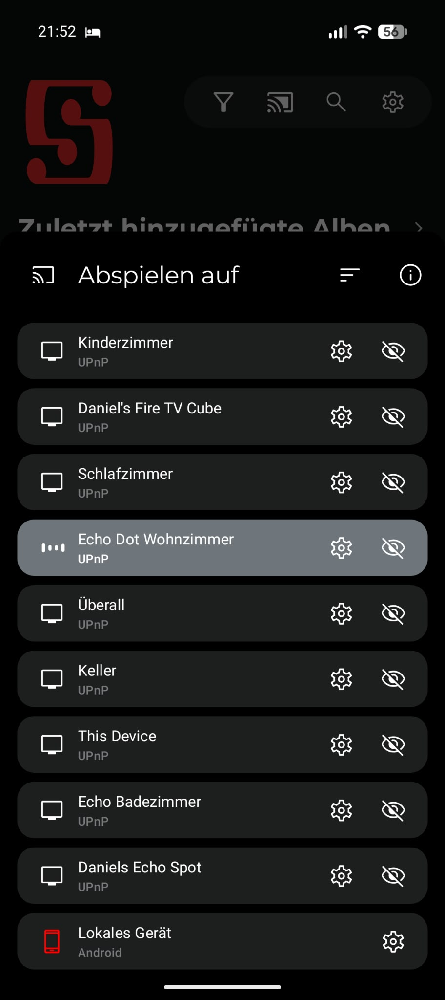

<div align="center"></div>

# castNavidrome

castNavidrome macht aus jedem Alexa-Gerät einen eigenen UPnP/DLNA-MediaRenderer, sodass DLNA-Clients (Symfonium, Supersonic, …) Musik auf einzelne Echoes casten können. Zusätzlich verbindet der Skill Alexa-Geräte mit einem Subsonic-API-kompatiblen Medienserver (z. B. Navidrome) für die sprachgesteuerte Wiedergabe deiner eigenen Musiksammlung.

<div align="center"></div>

**castNavidrome ist ein Fork von [AskNavidrome](https://github.com/rosskouk/asknavidrome)** (Ross Stewart, MIT-Lizenz) mit lokalen Erweiterungen aus mehreren Community-Forks sowie einem eingebauten UPnP-MediaRenderer für jedes Alexa-Gerät. Siehe [Fork von AskNavidrome](#fork-von-asknavidrome) und [CREDITS.md](CREDITS.md).

## Highlights

- **UPnP/DLNA-MediaRenderer:** jedes ausgewählte Alexa-Gerät erscheint in Navidrome als eigener Renderer, sodass DLNA-Clients (Symfonium, Supersonic, …) Titel an einzelne Echoes senden können.
- Musik nach Künstler, Album, Titel, Genre, Playlist, Jahrzehnt oder Freitextsuche abspielen.
- Wiedergabewarteschlange mischen, Lieder markieren/entmarkieren, Details des aktuellen Titels anzeigen.
- Radio-Streams und Playlist-Entdeckung ("spiele mehr Playlists wie diese", "finde eine Playlist").
- Hilfethemen und gesprochene Antworten in der Sprache des Echo-Geräts.
- Automatischer Amazon-Login über `aioamazondevices` mit TOTP; der Browser-Capture-Proxy bleibt als Fallback verfügbar.
- Läuft direkt mit Python oder in einem Docker-Container (empfohlen).

## Sprachen

Dieses README: Deutsch.
- [`README.md`](README.md) — English
- [`README.es.md`](README.es.md) — Español

Die Interaktionsmodelle für die Alexa Developer Console liegen in [`alexa/`](alexa) für `de-DE`, `en-US`, `es-ES`, `fr-FR`, `it-IT`, `pt-BR`.

## Fork von AskNavidrome

castNavidrome ist ein Fork von [rosskouk/asknavidrome](https://github.com/rosskouk/asknavidrome). Die Upstream-Features (Subsonic-API-Zugriff, Alexa-Skill-Handler, MediaQueue, Scrobbling, Multi-Threading bei großen Playlists) stammen von Ross Stewart.

Weitere Features wurden aus Community-Forks von AskNavidrome (alle MIT-lizenziert) und aus der lokalen Entwicklung übernommen. Den genauen Ursprung jedes Features, den Autor, den Fork und die lokalen Änderungen finden Sie in [CREDITS.md](CREDITS.md).

Lokale Features ohne Upstream-Vorlage:

- `skill/castnavidrome/upnp/` — eigener UPnP-MediaRenderer (SSDP, Description, SOAP, DIDL) pro Alexa-Gerät.
- `skill/castnavidrome/renderer_host.py` — Renderer-Host-Prozess, Gerätefilter, UUID-Persistenz.
- `skill/castnavidrome/renderer_registry.py` — stabiles Mapping Alexa-Gerät → UPnP-UUID (`ownerId` + `serialNumber`).
- `skill/castnavidrome/alexa_device_filter.py` — Geräteauswahl nach Typ, Name, Regex und Online-Status.
- `skill/castnavidrome/alexa_remote.py` — Textbefehle an Echo-Geräte, Geräteliste über die Amazon-Geräte-API.
- `skill/castnavidrome/localization.py` — lokalisierte Skill-Antworten und sprachspezifische Sprachbefehle.
- `alexa/` — Interaktionsmodelle, eine Datei pro Sprache.

Die Software steht unter der [MIT-Lizenz](LICENSE). Der ursprüngliche Copyright-Hinweis von Ross Stewart wird beibehalten; lokale Änderungen sind urheberrechtlich geschützt von den castNavidrome-Mitwirkenden (siehe `CREDITS.md` und `LICENSE`).

## Voraussetzungen

- Eine digitale Musiksammlung, bereitgestellt von einem Subsonic-API-kompatiblen Medienserver (getestet mit Navidrome).
- Der Medienserver muss über HTTPS mit einem gültigen TLS-Zertifikat erreichbar sein (Amazon verlangt dies für das Streaming).
- Ein Echo-Gerät, dessen Locale mit der Skill-Locale übereinstimmt.
- Ein in der [Alexa Developer Console](https://developer.amazon.com/alexa/console/ask) erstellter Alexa-Skill mit aktiviertem Audio-Player-Interface und einem HTTPS-Endpunkt, der auf diesen Webdienst zeigt.
- (Optional, für die Media-Renderer) Port `1900/udp` für die SSDP-Entdeckung verfügbar und der Container mit Host-Netzwerk oder macvlan.

## Installation

### Option 1: Docker Compose (empfohlen)

1. Beispielkonfiguration kopieren:
   ```bash
   cp .env.example .env
   ```
2. Bearbeiten Sie `.env` und tragen Sie Ihre eigenen Werte ein (Navidrome-URL, Benutzer, Passwort, Skill-ID, …).  
   `.env` wird **nicht** in die Versionskontrolle übernommen.
3. Starten Sie alles:
   ```bash
   docker compose up -d --build
   ```

Beispiel `docker-compose.yml`:

```yaml
services:
  castnavidrome:
    container_name: castnavidrome
    build:
      context: .
      dockerfile: Dockerfile
    image: castnavidrome:local
    environment:
      - NAVI_SKILL_ID=${NAVI_SKILL_ID}
      - NAVI_URL=${NAVI_URL}
      - NAVI_BASE_URL=${NAVI_BASE_URL}
      - NAVI_USER=${NAVI_USER}
      - NAVI_PASS=${NAVI_PASS}
      - NAVI_ALEXA_API_KEY=${NAVI_ALEXA_API_KEY}
      - NAVI_ALEXA_DOMAIN=${NAVI_ALEXA_DOMAIN:-amazon.com}
      - NAVI_ALEXA_COOKIE_FILE=/var/lib/castnavidrome/alexa.cookies
      - NAVI_ALEXA_CAPTURE_PASSWORD=${NAVI_ALEXA_CAPTURE_PASSWORD}
      - NAVI_AMAZON_USER=${NAVI_AMAZON_USER:-}
      - NAVI_AMAZON_PASS=${NAVI_AMAZON_PASS:-}
      - NAVI_AMAZON_TOTP_SECRET=${NAVI_AMAZON_TOTP_SECRET:-}
    ports:
      - '127.0.0.1:3456:3456'  # Alexa-Browser-Login-Proxy
    volumes:
      - ./.secrets/alexa.cookies:/run/secrets/alexa.cookies:rw
      - ./state:/var/lib/castnavidrome
    logging:
      driver: "json-file"
      options:
        max-size: "10m"
        max-file: "1"
    depends_on:
      tailscale:
        condition: service_healthy
    restart: unless-stopped

  # Optional: stellt jedes ausgewählte Alexa-Gerät als eigenen UPnP-MediaRenderer bereit.
  # Benötigt das Host-Netzwerk, damit SSDP (Port 1900/udp) zur Entdeckung funktioniert.
  castnavidrome-renderer:
    build:
      context: .
      dockerfile: Dockerfile
    image: castnavidrome:local
    container_name: castnavidrome-renderer
    network_mode: host
    command: ["python3", "-m", "castnavidrome.renderer_host"]
    environment:
      - NAVI_URL=${NAVI_URL}
      - NAVI_USER=${NAVI_USER}
      - NAVI_PASS=${NAVI_PASS}
      - NAVI_ALEXA_API_KEY=${NAVI_ALEXA_API_KEY}
      - NAVI_ALEXA_SKILL_NAME=${NAVI_ALEXA_SKILL_NAME}
      - NAVI_ALEXA_DOMAIN=${NAVI_ALEXA_DOMAIN:-amazon.com}
      - NAVI_ALEXA_COOKIE_FILE=/var/lib/castnavidrome/alexa.cookies
      - NAVI_AMAZON_USER=${NAVI_AMAZON_USER:-}
      - NAVI_AMAZON_PASS=${NAVI_AMAZON_PASS:-}
      - NAVI_AMAZON_TOTP_SECRET=${NAVI_AMAZON_TOTP_SECRET:-}
      - NAVI_ALEXA_RENDERER_AUTO_RESTART=true
    volumes:
      - ./.secrets/alexa.cookies:/run/secrets/alexa.cookies:rw
      - ./state:/var/lib/castnavidrome
    restart: unless-stopped

  tailscale:
    image: tailscale/tailscale:latest
    container_name: tailscale-${SERVICE}
    hostname: ${SERVICE}
    environment:
      - TS_AUTHKEY=${TS_AUTHKEY}
      - TS_STATE_DIR=/var/lib/tailscale
      - TS_SERVE_CONFIG=/config/serve.json
      - TS_USERSPACE=false
      - TS_ENABLE_HEALTH_CHECK=true
      - TS_LOCAL_ADDR_PORT=127.0.0.1:41234
      - TS_AUTH_ONCE=true
    volumes:
      - ./config:/config
      - ./ts/state:/var/lib/tailscale
    devices:
      - /dev/net/tun:/dev/net/tun
    cap_add:
      - net_admin
    ports:
      - 0.0.0.0:${SERVICEPORT}:${SERVICEPORT}
    healthcheck:
      test: ["CMD", "wget", "--spider", "-q", "http://127.0.0.1:41234/healthz"]
      interval: 1m
      timeout: 10s
      retries: 3
      start_period: 10s
    restart: unless-stopped
```

Nur die erforderlichen Variablen und festen Pfade stehen in der Compose-Datei. Jede andere Einstellung hat einen sinnvollen Standardwert im Code und kann bei Bedarf in `.env` ergänzt werden (siehe [Konfiguration](#konfiguration)). Die Cookie-Datei (`.secrets/alexa.cookies`) und das State-Verzeichnis (`state/`) sind nur lokal und werden über `.gitignore` von der Versionskontrolle ausgeschlossen.

### Option 2: Direkt mit Python ausführen

```bash
cd skill
python3 -m venv .venv
source .venv/bin/activate
pip install -r requirements-full.txt

NAVI_SKILL_ID=<ihre-skill-id> \
NAVI_URL=https://ihr-navidrome.test \
NAVI_USER=<benutzername> \
NAVI_PASS=<passwort> \
NAVI_PORT=443 \
NAVI_API_PATH=/rest \
NAVI_API_VER=1.16.1 \
python3 app.py
```

Alle Umgebungsvariablen siehe [Konfiguration](#konfiguration).

## Alexa-Skill einrichten

1. Erstellen Sie einen Custom Skill in der [Alexa Developer Console](https://developer.amazon.com/alexa/console/ask).
2. Legen Sie als primäre Locale die Locale Ihres Echo-Geräts fest (muss übereinstimmen).
3. Laden Sie ein Interaktionsmodell aus [`alexa/`](alexa) unter *Interaction Model → JSON Editor* hoch (z. B. `alexa/de-DE.json`) und speichern Sie das Modell.
4. Fügen Sie Ihre Playlist-Namen dem Slot-Typ `playlist_names` hinzu.
5. Aktivieren Sie unter *Interfaces* das *Audio Player*-Interface.
6. Legen Sie den Endpunkt auf die HTTPS-URL dieses Webdieners (Standard-Region) fest und speichern Sie ihn.
7. Bauen Sie das Modell und fügen Sie den Skill Ihren Echo-Geräten als Entwicklungsskill hinzu.

### Skill-ID

Die `NAVI_SKILL_ID` ist die eindeutige Kennung Ihres Alexa-Skills. Sie finden sie in der [Alexa Developer Console](https://developer.amazon.com/alexa/console/ask):

1. Öffnen Sie Ihren Skill in der Developer Console.
2. Gehen Sie zu **Skill → Information** (oder dem Tab **Usage** in manchen Konsolen).
3. Kopieren Sie die **Skill-ID** (sieht aus wie `amzn1.ask.skill.xxxxxxxx-…`).
4. Setzen Sie sie als `NAVI_SKILL_ID` in Ihrer `.env`.

Wenn `NAVI_SKILL_ID` nicht gesetzt ist, antwortet der Webdienst auf jede Skill-Anfrage.

### Externe URL mit Tailscale Funnel

Damit Alexa Ihren Skill erreichen kann und Navidrome Cover streamen kann, benötigen beide eine öffentliche HTTPS-URL. Sie können eine mit [Tailscale Funnel](https://tailscale.com/kb/1216/funnel) erstellen, ohne Ports im Router zu öffnen:

1. Installieren Sie Tailscale auf dem Host, auf dem castNavidrome und Navidrome laufen.
2. Exponieren Sie den castNavidrome-Webdienst:
   ```bash
   tailscale funnel on 443
   ```
   (oder den Port, auf dem der Container lauscht, zum Beispiel `8000`).
3. Exponieren Sie Navidrome auf die gleiche Weise, falls es nicht bereits aus dem Internet erreichbar ist:
   ```bash
   tailscale funnel on 443
   ```
4. Tailscale gibt Ihnen einen DNS-Namen wie `yourdevice.tailxxxxyyyy.ts.net`. Verwenden Sie ihn als:
   - `NAVI_URL` — die Navidrome-Server-URL, zum Beispiel `https://yourdevice.tailxxxxyyyy.ts.net`
   - `NAVI_BASE_URL` — die öffentliche URL dieses Skills, zum Beispiel `https://yourdevice.tailxxxxyyyy.ts.net`
   - Den HTTPS-Endpunkt in der Alexa Developer Console, der auf Ihren castNavidrome-Dienst zeigt.

Tailscale Funnel beendet TLS am Tailscale Edge, sodass Alexas HTTPS-Anforderung erfüllt ist, ohne dass Sie Zertifikate verwalten müssen.

### Alternative: Tailscale als Sidecar-Container

Wenn Sie Tailscale nicht auf dem Host installieren möchten, betreiben Sie es stattdessen als Sidecar-Container. castNavidrome teilt sich dann den Netzwerk-Namespace des Tailscale-Containers (`network_mode: service:tailscale`) und ist über die Tailscale-Funnel-Adresse erreichbar, ohne Tailscale auf dem Host zu benötigen.

Fügen Sie einen `tailscale`-Service zu Ihrer `docker-compose.yml` hinzu:

```yaml
services:
  tailscale:
    image: tailscale/tailscale:latest
    container_name: tailscale
    environment:
      - TS_AUTHKEY=${TS_AUTHKEY}
    cap_add:
      - NET_ADMIN
    volumes:
      - tailscale-state:/var/lib/tailscale
    restart: unless-stopped

  castnavidrome:
    container_name: castnavidrome
    build:
      context: .
      dockerfile: Dockerfile
    image: castnavidrome:local
    network_mode: service:tailscale
    environment:
      - NAVI_SKILL_ID=${NAVI_SKILL_ID}
      - NAVI_URL=https://yourdevice.tailxxxxyyyy.ts.net
      - NAVI_BASE_URL=https://yourdevice.tailxxxxyyyy.ts.net
      - NAVI_USER=${NAVI_USER}
      - NAVI_PASS=${NAVI_PASS}
      - NAVI_PORT=443
      - NAVI_API_PATH=/rest
      - NAVI_API_VER=1.16.1
      - NAVI_SONG_COUNT=50
      - NAVI_DEBUG=0
      - NAVI_ALEXA_API_KEY=${NAVI_ALEXA_API_KEY}
      - NAVI_ALEXA_DOMAIN=${NAVI_ALEXA_DOMAIN:-amazon.com}
      - NAVI_ALEXA_LOCALE=${NAVI_ALEXA_LOCALE:-en-US}
      - NAVI_ALEXA_SKILL_NAME=${NAVI_ALEXA_SKILL_NAME:-castnavidrome}
      - NAVI_ALEXA_COOKIE_FILE=/var/lib/castnavidrome/alexa.cookies
      - NAVI_ALEXA_CAPTURE_PASSWORD=${NAVI_ALEXA_CAPTURE_PASSWORD}
    volumes:
      - ./.secrets/alexa.cookies:/run/secrets/alexa.cookies:rw
      - ./state:/var/lib/castnavidrome
    restart: unless-stopped

volumes:
  tailscale-state:
```

Autorisieren Sie das Tailscale-Gerät (über die Tailscale-Verwaltungskonsole oder `docker exec tailscale tailscale up --authkey=...`) und aktivieren Sie Funnel:

```bash
docker exec tailscale tailscale funnel on 443
```

Die restliche Konfiguration (`NAVI_URL`, `NAVI_BASE_URL`, Alexa-Endpunkt) bleibt gleich wie im hostbasierten Ansatz oben.

Der Invocation-Name ist in allen Locales identisch und wird mit `NAVI_ALEXA_SKILL_NAME` festgelegt.

**Tipp:** Wählen Sie einen Invocation-Namen, der nichts mit einem Musikdienst zu tun hat (nicht "Spotify", "Apple Music", "Amazon Music", "Navidrome", …). Sonst versucht Alexa möglicherweise, Ihre Anfrage an einen anderen Music Skill weiterzuleiten, und Ihre eigene Musiksammlung wird nicht abgespielt.

## Docker-Image bauen

```bash
docker build -t castnavidrome:local .
```

Multi-Architektur-Images lassen sich mit `docker buildx` erstellen (die Dockerfile zielt auf `alpine:3.19` ab). Das Image wird nicht automatisch veröffentlicht; bauen und pushen Sie es vor einem Release in Ihre eigene Registry.

## Konfiguration

Der Dienst liest seine Konfiguration aus Umgebungsvariablen.

### Erforderlich

| Variable | Beschreibung | Beispiel |
|---|---|---|
| `NAVI_SKILL_ID` | ID Ihres Alexa-Skills (schränkt den Webdienst auf Ihren Skill ein) | `amzn1.ask.skill.xxxxxxxx-…` |
| `NAVI_URL` | URL des Subsonic-API-Servers (`https://`, ohne abschließenden Schrägstrich) | `https://navidrome.example.test` |
| `NAVI_USER` | Navidrome-Benutzername | `bob` |
| `NAVI_PASS` | Navidrome-Passwort | — |
| `NAVI_PORT` | Port des Subsonic-API-Servers | `443` |
| `NAVI_API_PATH` | Subsonic-API-Pfad | `/rest` |
| `NAVI_API_VER` | Subsonic-API-Version | `1.16.1` |
| `NAVI_SONG_COUNT` | Minimale Liedanzahl für Zufalls-/Genre-/Künstler-Playlists | `50` |

### Optional

| Variable | Beschreibung | Beispiel |
|---|---|---|
| `NAVI_BASE_URL` | Öffentliche URL dieses Skills (wird für Cover-Art auf Alexa-Karten verwendet) | `https://castnavidrome.example.test` |
| `NAVI_DEBUG` | Debug-Level (0–3) | `0` |
| `NAVI_DEBUG_TOKEN` | Token zum Schutz der `/debug/*`-Endpunkte | — |
| `NAVI_ALEXA_API_KEY` | API-Key im Header `X-API-Key` für `/api/alexa/*`. Selbst erzeugen, zum Beispiel mit `openssl rand -hex 32`. | `openssl rand -hex 32` |
| `NAVI_ALEXA_DOMAIN` | Amazon-Domain | `amazon.com` |
| `NAVI_ALEXA_LOCALE` | Locale der Skill-Antworten und Sprachbefehle | `en-US` |
| `NAVI_ALEXA_SKILL_NAME` | Invocation-Name des Skills | `castnavidrome` |
| `NAVI_ALEXA_COOKIE_FILE` | Gemeinsamer Pfad zur persistenten Alexa-Cookie-Datei | `/var/lib/castnavidrome/alexa.cookies` |
| `NAVI_ALEXA_CAPTURE_PASSWORD` | Passwort zum Schutz der Cookie-Capture-UI unter `/api/alexa/cookie/save` | — |
| `NAVI_ALEXA_AIODATA_FILE` | Geschützte persistente aioamazondevices-Login-Daten im gemeinsamen State-Volume | `/var/lib/castnavidrome/aioamazondevices/login.json` |
| `NAVI_AMAZON_USER` / `NAVI_AMAZON_PASS` / `NAVI_AMAZON_TOTP_SECRET` | Amazon-Zugangsdaten und Base32-TOTP-Secret für den automatischen Renderer-Login | — |

| `NAVI_RADIO_URL` / `NAVI_RADIO_STATIONS_URL` | Radio-Stream-URLs | — |
| `NAVI_PLAYLIST_NAME_PATTERN` / `_SPOKEN_FORMAT` / `_QUALIFIED_FORMAT` | Playlist-Namen-Gruppierung und gesprochene Formate | — |

### Media-Renderer (`castnavidrome-renderer`)

| Variable | Beschreibung | Beispiel |
|---|---|---|
| `NAVI_ALEXA_RENDERER_ENABLED` | Renderer aktivieren | `yes` |
| `NAVI_ALEXA_RENDERER_PORT` | UPnP-Beschreibungs-/Steuerungsport | `49443` |
| `NAVI_ALEXA_RENDERER_ANNOUNCE` | Welche Titel angesagt werden: `explicit`, `always`, `never` | `explicit` |
| `NAVI_ALEXA_RENDERER_ANNOUNCE_INTERVAL` | Sekunden zwischen den periodischen SSDP `ssdp:alive`-Ansagen (`<= 0` deaktiviert die Schleife) | `720` |
| `NAVI_ALEXA_RENDERER_DISABLE_ANNOUNCE` | Periodische SSDP-Ankündigungen deaktivieren (`true`/`false`) | `false` |
| `NAVI_ALEXA_RENDERER_NOTIFY_COUNT` | Wie oft `ssdp:alive`/`ssdp:byebye` wiederholt wird (`0` = keine Wiederholungen) | `3` |
| `NAVI_ALEXA_RENDERER_NOTIFY_DELAY` | Sekunden zwischen SSDP-Notify-Wiederholungen (`0` = keine Verzögerung) | `0.4` |
| `NAVI_ALEXA_RENDERER_CLIENT_TIMEOUT` | Sekunden Inaktivität des Clients, nach denen die Wiedergabe stoppt (`0` = deaktiviert) | `0` |
| `NAVI_ALEXA_RENDERER_STATE_FILE` | Registry, die Alexa-Geräte auf Renderer-UUIDs abbildet | `/var/lib/castnavidrome/renderer-devices.json` |
| `NAVI_ALEXA_RENDERER_NAME_PREFIX` | Präfix für Renderer-Namen | — |
| `NAVI_ALEXA_RENDERER_DEVICE_TYPES` | Erlaubte Gerätetypen (kommagetrennt) | `ECHO,FIRE_TV` |
| `NAVI_ALEXA_RENDERER_NAME_REGEX` | Regex, dem Gerätenamen entsprechen muss | `^Echo` |
| `NAVI_ALEXA_RENDERER_ONLY_ONLINE` | Nur Online-Geräte anzeigen | `no` |
| `NAVI_ALEXA_RENDERER_LOG_LEVEL` | Log-Level | `INFO` |

Die Ankündigungsmodi (`explicit` = Standard: vom Nutzer gestartete Titel werden angesagt, vom Renderer selbst gestartete Titel spielen still) siehe `CREDITS.md`.

## Änderungen gegenüber AskNavidrome

castNavidrome behält das Upstream-Verhalten von AskNavidrome bei und fügt hinzu:

- UPnP-MediaRenderer pro Alexa-Gerät (neuer Container/Prozess, Host-Netzwerk).
- Lokalisierung in sechs Sprachen mit sprachspezifischen Sprachbefehlen.
- Freitextsuche (`castNavidromePlaySearch`), Musik nach Jahrzehnt, Titel nach Name, Playlist-Entdeckung, Radio-Streams, Hilfethemen.
- Amazon-Cookie-Login über Browser-Capture-Proxy (`skill/castnavidrome/cookie_capture_proxy.py`).
- Geschützte Debug-Endpunkte (`NAVI_DEBUG_TOKEN`) und keine Session-Token/Stream-URIs in Protokollen oder der Debug-Tabelle.

Jedes übernommene Feature und sein Ursprung sind in [CREDITS.md](CREDITS.md) mit den vorgenommenen lokalen Änderungen aufgelistet.

### Amazon-Login (automatisch, Browser-Fallback)

Wenn `NAVI_AMAZON_USER`, `NAVI_AMAZON_PASS` und `NAVI_AMAZON_TOTP_SECRET` gesetzt sind, meldet sich der Renderer beim Start automatisch mit `aioamazondevices` an; ein Browser-Login-Klick ist nicht nötig. Der wiederverwendbare Login-Zustand wird unter `/var/lib/castnavidrome/aioamazondevices/login.json` im `./state`-Volume mit Dateirechten `0600` gespeichert. `NAVI_ALEXA_LOCALE` steuert die Sprache der Textbefehle unabhängig von der Amazon-Domain.

Mit diesem Login fragt der Renderer während der Wiedergabe etwa alle fünf Sekunden den von Amazon gemeldeten Echo-Status ab und meldet erkannte Pausen und Stopps per UPnP an den Client. Bei fehlenden oder verzögerten Statusdaten bleibt der letzte bekannte Zustand bestehen; der Browser-Cookie-Fallback allein aktiviert diese Überwachung nicht.

Gibt ein UPnP-Client den nächsten Titel über `SetNextAVTransportURI` vor, verwendet der Renderer diesen anstelle der aus dem Album abgeleiteten Reihenfolge. Bei einem Renderer-Titelstart werden Echo und Renderer anhand des zeitnah gestarteten Titels automatisch zugeordnet. Ein am Echo gesprochenes „Weiter“ kann dann den nächsten Renderer-Titel abspielen. Ist die Zuordnung mehrdeutig oder abgelaufen, wird nicht geraten. Beide Container benötigen dafür dasselbe beschreibbare `state`-Volume.

Der bisherige Browser-Capture-Proxy bleibt als Fallback verfügbar, falls Amazon einen zusätzlichen Challenge-Schritt verlangt oder die automatische Anmeldung nicht möglich ist.

#### Browser-Fallback konfigurieren

Setze `NAVI_ALEXA_CAPTURE_PASSWORD` in deiner `.env`, um die Cookie-Capture-UI zu schützen:

```env
NAVI_ALEXA_CAPTURE_PASSWORD=dein-geheimes-passwort
```

Setze `NAVI_ALEXA_DOMAIN` auf die Domain, auf der die Alexa-Webanmeldung tatsächlich endet. Sie muss nicht dem Amazon-Shop-Marktplatz entsprechen: Leitet die Anmeldung auf `amazon.com` weiter, verwende `amazon.com` auch mit einem deutschen Amazon-Konto. Die Gerätesprache wird unabhängig davon über `NAVI_ALEXA_LOCALE` festgelegt.

```env
NAVI_ALEXA_DOMAIN=amazon.com
```

#### Schritt für Schritt

1. Baue und starte die Container:

   ```bash
   docker compose up -d --build
   ```

2. Öffne die Cookie-Login-Seite im Browser (Basic Auth mit dem Capture-Passwort):

   ```
   https://deine-castnavidrome-domain.test/api/alexa/cookie/save
   ```

   Der Benutzername kann beliebig sein; das Passwort ist `NAVI_ALEXA_CAPTURE_PASSWORD`.

3. Klicke auf der Seite auf die Proxy-URL, um die Amazon-Anmeldung im Capture-Proxy zu öffnen. Melde dich mit deinen Amazon-Anmeldeinformationen an (und TOTP, falls angefordert).

4. Nach erfolgreichem Login erfasst der Proxy automatisch die Session-Cookies und schreibt sie in die Cookie-Datei. Der Status-Endpunkt zeigt an, ob die Session gültig ist:

   ```bash
   curl -u :dein-capture-passwort https://deine-castnavidrome-domain.test/api/alexa/cookie/proxy/status
   ```

   Achte auf `"login_success": true` und `"has_csrf": true`.

5. Der Renderer-Container (`castnavidrome-renderer`) teilt sich dasselbe `./state`-Volume und übernimmt automatisch die Cookies aus `/var/lib/castnavidrome/alexa.cookies`.

#### Hinweise

- Cookies werden in `alexa.cookies` geschrieben (SimpleCookie-Format, `name=value` pro Zeile), nicht in `amazon_session.json`.
- Fehlt das `csrf`-Cookie nach dem Login, aktualisiere die Status-Seite – Amazon setzt `csrf` bei einer anschließenden Anfrage an die Alexa-Domain, was der Proxy jetzt automatisch auslöst.
- Der Renderer-Container kann beim Start „Could not ensure Amazon session, falling back to cached cookies“ protokollieren. Das ist erwartetes Verhalten – er greift auf die gemeinsame Cookie-Datei zurück und benötigt keinen eigenen Amazon-Login.


## Sicherheit
- Die Alexa-Cookie-Datei (`.secrets/alexa.cookies` bzw. `state/alexa.cookies`) und `NAVI_ALEXA_CAPTURE_PASSWORD` sind sensibel. Halten Sie `.secrets/` und `.env` aus der Versionskontrolle heraus (stehen in `.gitignore`).
- Stellen Sie die Endpunkte `/api/alexa/*` und `/debug/*` nicht ohne `NAVI_ALEXA_API_KEY` und HTTPS ins öffentliche Internet.

## Lizenz

MIT-Lizenz. Copyright (c) 2022 Ross Stewart; lokale Änderungen Copyright (c) 2026 castNavidrome-Mitwirkende. Siehe [LICENSE](LICENSE) und [CREDITS.md](CREDITS.md).

## Disclaimer

Dieses Projekt ist vibe gecoded: es wurde schnell mit KI-Unterstützung zusammengestellt und hat keine gründliche Sicherheits- oder Code-Prüfung durchlaufen. Betrachten Sie es als Ausgangspunkt, nicht als produktionsreife Software. Secrets und persönliche Daten sind über `.gitignore` von der Versionskontrolle ausgeschlossen, aber Sie sind selbst dafür verantwortlich, alles, was Sie ausführen, zu prüfen und zu validieren.
