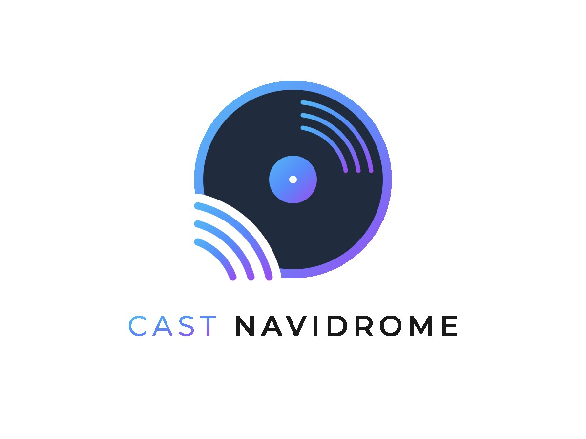
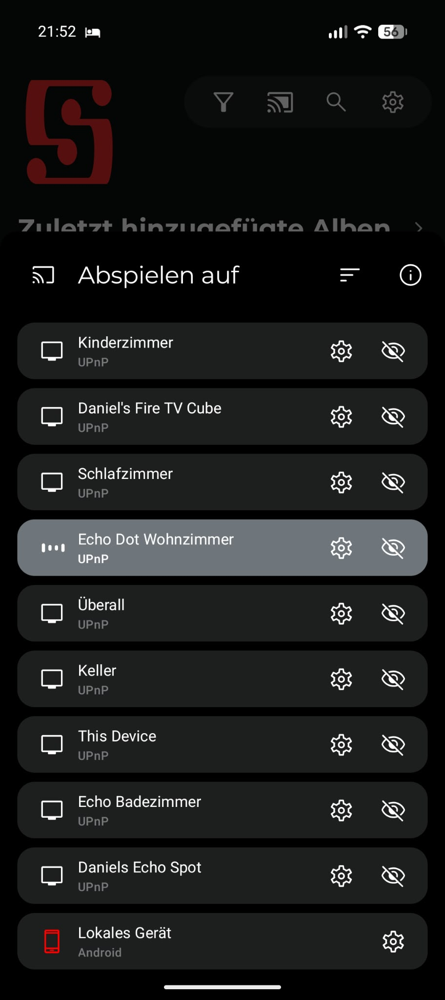

<div align="center"></div>

# castNavidrome

castNavidrome convierte cada dispositivo Alexa en su propio MediaRenderer UPnP/DLNA, para que clientes DLNA (Symfonium, Supersonic, …) puedan enviar música a Echos individuales. También conecta dispositivos Alexa a un servidor multimedia compatible con la API Subsonic (por ejemplo Navidrome) para reproducción controlada por voz de tu propia colección de música.

<div align="center"></div>

**castNavidrome es un fork de [AskNavidrome](https://github.com/rosskouk/asknavidrome)** (Ross Stewart, licencia MIT) con extensiones locales de varios forks comunitarios además de un MediaRenderer UPnP integrado para cada dispositivo Alexa. Consulta [Fork de AskNavidrome](#fork-de-asknavidrome) y [CREDITS.md](CREDITS.md).

## Puntos destacados

- **MediaRenderer UPnP/DLNA:** cada dispositivo Alexa seleccionado aparece como su propio renderer en Navidrome, para que clientes DLNA (Symfonium, Supersonic, …) puedan enviar pistas a Echos individuales.
- Reproduce música por artista, álbum, canción, género, lista de reproducción, década o consulta de texto libre.
- Mezcla la cola de reproducción, marca/desmarca canciones, muestra detalles de la pista actual.
- Emisiones de radio y descubrimiento de listas de reproducción ("reproduce más listas como esta", "encuentra una lista").
- Temas de ayuda y respuestas habladas en el idioma del dispositivo Echo.
- Inicio de sesión de Amazon mediante proxy de captura de cookies por navegador (recomendado, reemplaza la copia manual de cookies y el inicio de sesión TOTP).
- Se ejecuta directamente con Python o en un contenedor Docker (recomendado).

## Idiomas

Este README: Español.
- [`README.md`](README.md) — English
- [`README.de.md`](README.de.md) — Deutsch

Los modelos de interacción para la consola para desarrolladores de Alexa están en [`alexa/`](alexa) para `de-DE`, `en-US`, `es-ES`, `fr-FR`, `it-IT`, `pt-BR`.

## Fork de AskNavidrome

castNavidrome es un fork de [rosskouk/asknavidrome](https://github.com/rosskouk/asknavidrome). Las características upstream (acceso a la API Subsonic, controlador de skill de Alexa, MediaQueue, scrobbling, multi-hilo para listas grandes) provienen de Ross Stewart.

Las características adicionales se adoptaron de forks comunitarios de AskNavidrome (todos con licencia MIT) y del desarrollo local. El origen exacto de cada característica, el autor, el fork y los cambios locales están documentados en [CREDITS.md](CREDITS.md).

Características locales sin plantilla upstream:

- `skill/castnavidrome/upnp/` — propio MediaRenderer UPnP (SSDP, Description, SOAP, DIDL) por dispositivo Alexa.
- `skill/castnavidrome/renderer_host.py` — proceso host del renderer, filtro de dispositivos, persistencia de UUID.
- `skill/castnavidrome/renderer_registry.py` — mapeo estable dispositivo Alexa → UUID UPnP (`ownerId` + `serialNumber`).
- `skill/castnavidrome/alexa_device_filter.py` — selección de dispositivos por tipo, nombre, regex y estado en línea.
- `skill/castnavidrome/alexa_remote.py` — comandos de texto a dispositivos Alexa, lista de dispositivos a través de la API de dispositivos de Amazon.
- `skill/castnavidrome/localization.py` — respuestas localizadas del skill y comandos de voz específicos del idioma.
- `alexa/` — modelos de interacción, un archivo por idioma.

El software se distribuye bajo la [licencia MIT](LICENSE). El aviso de copyright original de Ross Stewart se conserva; las modificaciones locales son copyright de los contribuyentes de castNavidrome (consulta `CREDITS.md` y `LICENSE`).

## Requisitos

- Una colección de música digital servida por un servidor multimedia compatible con la API Subsonic (probado con Navidrome).
- El servidor multimedia debe ser accesible mediante HTTPS con un certificado TLS válido (Amazon lo requiere para la transmisión).
- Un dispositivo Echo cuya configuración regional coincida con la configuración regional del skill.
- Un skill de Alexa creado en la [Consola para desarrolladores de Alexa](https://developer.amazon.com/alexa/console/ask), con la interfaz de reproductor de audio habilitada y el punto de conexión HTTPS apuntando a este servicio web.
- (Opcional, para los media renderers) el puerto `1900/udp` disponible para el descubrimiento SSDP y el contenedor capaz de usar la red de host o una macvlan.

## Instalación

### Opción 1: Docker Compose (recomendado)

1. Copia la configuración de ejemplo:
   ```bash
   cp .env.example .env
   ```
2. Edita `.env` y completa tus propios valores (URL de Navidrome, usuario, contraseña, ID del skill, …).  
   `.env` **no** se confirma en el control de versiones.
3. Inicia todo:
   ```bash
   docker compose up -d --build
   ```

Ejemplo `docker-compose.yml`:

```yaml
services:
  castnavidrome:
    container_name: castnavidrome
    build:
      context: .
      dockerfile: Dockerfile
    image: castnavidrome:local
    environment:
      - NAVI_SKILL_ID=${NAVI_SKILL_ID}
      - NAVI_URL=${NAVI_URL}
      - NAVI_BASE_URL=${NAVI_BASE_URL}
      - NAVI_USER=${NAVI_USER}
      - NAVI_PASS=${NAVI_PASS}
      - NAVI_ALEXA_API_KEY=${NAVI_ALEXA_API_KEY}
      - NAVI_ALEXA_DOMAIN=${NAVI_ALEXA_DOMAIN:-amazon.com}
      - NAVI_ALEXA_COOKIE_FILE=/var/lib/castnavidrome/alexa.cookies
      - NAVI_ALEXA_CAPTURE_PASSWORD=${NAVI_ALEXA_CAPTURE_PASSWORD}
      - NAVI_AMAZON_USER=${NAVI_AMAZON_USER:-}
      - NAVI_AMAZON_PASS=${NAVI_AMAZON_PASS:-}
      - NAVI_AMAZON_TOTP_SECRET=${NAVI_AMAZON_TOTP_SECRET:-}
    ports:
      - '127.0.0.1:3456:3456'  # Alexa browser-login proxy
    volumes:
      - ./.secrets/alexa.cookies:/run/secrets/alexa.cookies:rw
      - ./state:/var/lib/castnavidrome
    logging:
      driver: "json-file"
      options:
        max-size: "10m"
        max-file: "1"
    depends_on:
      tailscale:
        condition: service_healthy
    restart: unless-stopped

  # Opcional: expone cada dispositivo Alexa seleccionado como su propio MediaRenderer UPnP.
  # Requiere la red de host para que SSDP (puerto 1900/udp) funcione para el descubrimiento.
  castnavidrome-renderer:
    build:
      context: .
      dockerfile: Dockerfile
    image: castnavidrome:local
    container_name: castnavidrome-renderer
    network_mode: host
    command: ["python3", "-m", "castnavidrome.renderer_host"]
    environment:
      - NAVI_URL=${NAVI_URL}
      - NAVI_USER=${NAVI_USER}
      - NAVI_PASS=${NAVI_PASS}
      - NAVI_ALEXA_API_KEY=${NAVI_ALEXA_API_KEY}
      - NAVI_ALEXA_SKILL_NAME=${NAVI_ALEXA_SKILL_NAME}
      - NAVI_ALEXA_DOMAIN=${NAVI_ALEXA_DOMAIN:-amazon.com}
      - NAVI_ALEXA_COOKIE_FILE=/var/lib/castnavidrome/alexa.cookies
      - NAVI_AMAZON_USER=${NAVI_AMAZON_USER:-}
      - NAVI_AMAZON_PASS=${NAVI_AMAZON_PASS:-}
      - NAVI_AMAZON_TOTP_SECRET=${NAVI_AMAZON_TOTP_SECRET:-}
      - NAVI_ALEXA_RENDERER_AUTO_RESTART=true
    volumes:
      - ./.secrets/alexa.cookies:/run/secrets/alexa.cookies:rw
      - ./state:/var/lib/castnavidrome
    restart: unless-stopped

  tailscale:
    image: tailscale/tailscale:latest
    container_name: tailscale-${SERVICE}
    hostname: ${SERVICE}
    environment:
      - TS_AUTHKEY=${TS_AUTHKEY}
      - TS_STATE_DIR=/var/lib/tailscale
      - TS_SERVE_CONFIG=/config/serve.json
      - TS_USERSPACE=false
      - TS_ENABLE_HEALTH_CHECK=true
      - TS_LOCAL_ADDR_PORT=127.0.0.1:41234
      - TS_AUTH_ONCE=true
    volumes:
      - ./config:/config
      - ./ts/state:/var/lib/tailscale
    devices:
      - /dev/net/tun:/dev/net/tun
    cap_add:
      - net_admin
    ports:
      - 0.0.0.0:${SERVICEPORT}:${SERVICEPORT}
    healthcheck:
      test: ["CMD", "wget", "--spider", "-q", "http://127.0.0.1:41234/healthz"]
      interval: 1m
      timeout: 10s
      retries: 3
      start_period: 10s
    restart: unless-stopped
```

Solo las variables requeridas y las rutas fijas están en el archivo Compose. Todos los demás valores tienen un valor predeterminado razonable en el código y se pueden agregar a `.env` cuando sea necesario (consulte [Configuración](#configuración)). El archivo de cookies (`.secrets/alexa.cookies`) y el directorio de estado (`state/`) son solo locales y se excluyen del control de versiones mediante `.gitignore`.

### Opción 2: Ejecutar directamente con Python

```bash
cd skill
python3 -m venv .venv
source .venv/bin/activate
pip install -r requirements-full.txt

NAVI_SKILL_ID=<tu-id-de-skill> \
NAVI_URL=https://tu-navidrome.test \
NAVI_USER=<usuario> \
NAVI_PASS=<contraseña> \
NAVI_PORT=443 \
NAVI_API_PATH=/rest \
NAVI_API_VER=1.16.1 \
python3 app.py
```

Todas las variables de entorno en [Configuración](#configuración).

## Configurar el skill de Alexa

1. Crea un skill personalizado en la [Consola para desarrolladores de Alexa](https://developer.amazon.com/alexa/console/ask).
2. Establece como configuración regional principal la de tu dispositivo Echo (debe coincidir).
3. Sube uno de los modelos de interacción de [`alexa/`](alexa) en *Modelo de interacción → Editor JSON* (por ejemplo `alexa/es-ES.json`) y guarda el modelo.
4. Agrega los nombres de tus listas de reproducción al tipo de ranura `playlist_names`.
5. Activa la interfaz *Reproductor de audio* en *Interfaces*.
6. Establece el punto de conexión en la URL HTTPS de este servicio web (región predeterminada) y guárdalo.
7. Compila el modelo y agrega el skill a tus dispositivos Echo como skill de desarrollo.

### ID del skill

El `NAVI_SKILL_ID` es el identificador único de tu skill de Alexa. Lo encuentras en la [Consola para desarrolladores de Alexa](https://developer.amazon.com/alexa/console/ask):

1. Abre tu skill en la Consola para desarrolladores.
2. Ve a **Skill → Información** (o la pestaña **Usage** en algunas consolas).
3. Copia el **ID del skill** (se ve como `amzn1.ask.skill.xxxxxxxx-…`).
4. Configúralo como `NAVI_SKILL_ID` en tu `.env`.

Si `NAVI_SKILL_ID` no está configurado, el servicio web responde a cualquier solicitud de skill.

### URL externa con Tailscale Funnel

Para que Alexa pueda alcanzar tu skill y Navidrome pueda transmitir carátulas, ambos necesitan una URL HTTPS pública. Puedes crear una con [Tailscale Funnel](https://tailscale.com/kb/1216/funnel) sin abrir puertos en tu router:

1. Instala Tailscale en el host donde se ejecutan castNavidrome y Navidrome.
2. Expón el servicio web de castNavidrome:
   ```bash
   tailscale funnel on 443
   ```
   (o el puerto en el que el contenedor escucha, por ejemplo `8000`).
3. Expón Navidrome de la misma manera si no está ya accesible desde internet:
   ```bash
   tailscale funnel on 443
   ```
4. Tailscale te da un nombre DNS como `yourdevice.tailxxxxyyyy.ts.net`. Úsalo como:
   - `NAVI_URL` — la URL del servidor Navidrome, por ejemplo `https://yourdevice.tailxxxxyyyy.ts.net`
   - `NAVI_BASE_URL` — la URL pública de este skill, por ejemplo `https://yourdevice.tailxxxxyyyy.ts.net`
   - El punto de conexión HTTPS en la Consola para desarrolladores de Alexa, que apunta a tu servicio castNavidrome.

Tailscale Funnel termina TLS en el borde de Tailscale, por lo que se cumple el requisito HTTPS de Alexa sin que tengas que gestionar certificados.

### Alternativa: Tailscale como contenedor sidecar

Si no quieres instalar Tailscale en el host, ejecútalo como contenedor sidecar. castNavidrome comparte entonces el espacio de nombres de red del contenedor de Tailscale (`network_mode: service:tailscale`), por lo que es accesible a través de la dirección de Tailscale Funnel sin necesidad de Tailscale en el host.

Añade un servicio `tailscale` a tu `docker-compose.yml`:

```yaml
services:
  tailscale:
    image: tailscale/tailscale:latest
    container_name: tailscale
    environment:
      - TS_AUTHKEY=${TS_AUTHKEY}
    cap_add:
      - NET_ADMIN
    volumes:
      - tailscale-state:/var/lib/tailscale
    restart: unless-stopped

  castnavidrome:
    container_name: castnavidrome
    build:
      context: .
      dockerfile: Dockerfile
    image: castnavidrome:local
    network_mode: service:tailscale
    environment:
      - NAVI_SKILL_ID=${NAVI_SKILL_ID}
      - NAVI_URL=https://yourdevice.tailxxxxyyyy.ts.net
      - NAVI_BASE_URL=https://yourdevice.tailxxxxyyyy.ts.net
      - NAVI_USER=${NAVI_USER}
      - NAVI_PASS=${NAVI_PASS}
      - NAVI_PORT=443
      - NAVI_API_PATH=/rest
      - NAVI_API_VER=1.16.1
      - NAVI_SONG_COUNT=50
      - NAVI_DEBUG=0
      - NAVI_ALEXA_API_KEY=${NAVI_ALEXA_API_KEY}
      - NAVI_ALEXA_DOMAIN=${NAVI_ALEXA_DOMAIN:-amazon.com}
      - NAVI_ALEXA_LOCALE=${NAVI_ALEXA_LOCALE:-en-US}
      - NAVI_ALEXA_SKILL_NAME=${NAVI_ALEXA_SKILL_NAME:-castnavidrome}
      - NAVI_ALEXA_COOKIE_FILE=/var/lib/castnavidrome/alexa.cookies
      - NAVI_ALEXA_CAPTURE_PASSWORD=${NAVI_ALEXA_CAPTURE_PASSWORD}
    volumes:
      - ./.secrets/alexa.cookies:/run/secrets/alexa.cookies:rw
      - ./state:/var/lib/castnavidrome
    restart: unless-stopped

volumes:
  tailscale-state:
```

Autoriza el dispositivo Tailscale (a través de la consola de administración de Tailscale o `docker exec tailscale tailscale up --authkey=...`) y activa Funnel:

```bash
docker exec tailscale tailscale funnel on 443
```

El resto de la configuración (`NAVI_URL`, `NAVI_BASE_URL`, punto de conexión de Alexa) permanece igual que en el enfoque basado en el host descrito anteriormente.

El nombre de invocación es el mismo en todos los idiomas y se establece con `NAVI_ALEXA_SKILL_NAME`.

**Consejo:** Elige un nombre de invocación que no tenga nada que ver con un servicio de música (no "Spotify", "Apple Music", "Amazon Music", "Navidrome", …). De lo contrario, Alexa podría intentar enrutar tu solicitud a otra skill de música en lugar de castNavidrome, y no se reproducirá tu propia colección de música.

## Construir la imagen Docker

```bash
docker build -t castnavidrome:local .
```

Las imágenes de múltiples arquitecturas se pueden construir con `docker buildx` cuando sea necesario (el Dockerfile apunta a `alpine:3.22.1`). La imagen no se publica automáticamente; compílala y súbela a tu propio registro antes de lanzar un release.

## Configuración

El servicio lee su configuración de variables de entorno.

### Obligatorias

| Variable | Descripción | Ejemplo |
|---|---|---|
| `NAVI_SKILL_ID` | ID de tu skill de Alexa (limita el servicio web a tu skill) | `amzn1.ask.skill.xxxxxxxx-…` |
| `NAVI_URL` | URL del servidor de la API Subsonic (`https://`, sin barra final) | `https://navidrome.example.test` |
| `NAVI_USER` | Nombre de usuario de Navidrome | `bob` |
| `NAVI_PASS` | Contraseña de Navidrome | — |
| `NAVI_PORT` | Puerto del servidor de la API Subsonic | `443` |
| `NAVI_API_PATH` | Ruta de la API Subsonic | `/rest` |
| `NAVI_API_VER` | Versión de la API Subsonic | `1.16.1` |
| `NAVI_SONG_COUNT` | Número mínimo de canciones para listas aleatorias/género/artista | `50` |

### Opcionales

| Variable | Descripción | Ejemplo |
|---|---|---|
| `NAVI_BASE_URL` | URL pública de este skill (se usa para las portadas en las tarjetas de Alexa) | `https://castnavidrome.example.test` |
| `NAVI_DEBUG` | Nivel de depuración (0–3) | `0` |
| `NAVI_DEBUG_TOKEN` | Token que protege los puntos finales `/debug/*` | — |
| `NAVI_ALEXA_API_KEY` | Clave API enviada en el encabezado `X-API-Key` para `/api/alexa/*`. Générala tú mismo, por ejemplo con `openssl rand -hex 32`. | `openssl rand -hex 32` |
| `NAVI_ALEXA_DOMAIN` | Dominio de Amazon | `amazon.com` |
| `NAVI_ALEXA_LOCALE` | Configuración regional de las respuestas y comandos de voz del skill | `en-US` |
| `NAVI_ALEXA_SKILL_NAME` | Nombre de invocación del skill | `castnavidrome` |
| `NAVI_ALEXA_COOKIE_FILE` | Ruta compartida al archivo persistente de cookies Alexa | `/var/lib/castnavidrome/alexa.cookies` |
| `NAVI_ALEXA_CAPTURE_PASSWORD` | Contraseña que protege la UI de captura de cookies en `/api/alexa/cookie/save` | — |
| `NAVI_ALEXA_AIODATA_FILE` | Datos privados y persistentes de inicio de sesión aioamazondevices en el volumen compartido | `/var/lib/castnavidrome/aioamazondevices/login.json` |
| `NAVI_AMAZON_USER` / `NAVI_AMAZON_PASS` / `NAVI_AMAZON_TOTP_SECRET` | Credenciales de Amazon y secreto TOTP Base32 para el inicio de sesión automático del renderer | — |
| `NAVI_RADIO_URL` / `NAVI_RADIO_STATIONS_URL` | URL de emisiones de radio | — |
| `NAVI_PLAYLIST_NAME_PATTERN` / `_SPOKEN_FORMAT` / `_QUALIFIED_FORMAT` | Agrupación y formato hablado de nombres de listas de reproducción | — |

### MediaRenderer (`castnavidrome-renderer`)

| Variable | Descripción | Ejemplo |
|---|---|---|
| `NAVI_ALEXA_RENDERER_ENABLED` | Habilitar los renderers | `yes` |
| `NAVI_ALEXA_RENDERER_PORT` | Puerto de descripción/control UPnP | `49443` |
| `NAVI_ALEXA_RENDERER_ANNOUNCE` | Qué pistas se anuncian: `explicit`, `always`, `never` | `explicit` |
| `NAVI_ALEXA_RENDERER_ANNOUNCE_INTERVAL` | Segundos entre los anuncios periódicos SSDP `ssdp:alive` (`<= 0` deshabilita el bucle) | `720` |
| `NAVI_ALEXA_RENDERER_DISABLE_ANNOUNCE` | Deshabilitar anuncios SSDP periódicos (`true`/`false`) | `false` |
| `NAVI_ALEXA_RENDERER_NOTIFY_COUNT` | Número de veces que se repiten `ssdp:alive`/`ssdp:byebye` (`0` = sin repeticiones) | `3` |
| `NAVI_ALEXA_RENDERER_NOTIFY_DELAY` | Segundos entre repeticiones de notificaciones SSDP (`0` = sin retraso) | `0.4` |
| `NAVI_ALEXA_RENDERER_CLIENT_TIMEOUT` | Segundos de inactividad del cliente tras los cuales se detiene la reproducción (`0` = deshabilitado) | `0` |
| `NAVI_ALEXA_RENDERER_STATE_FILE` | Registro que mapea dispositivos Alexa a UUID de renderer | `/var/lib/castnavidrome/renderer-devices.json` |
| `NAVI_ALEXA_RENDERER_NAME_PREFIX` | Prefijo para nombres de renderer | — |
| `NAVI_ALEXA_RENDERER_DEVICE_TYPES` | Tipos de dispositivo permitidos (separados por comas) | `ECHO,FIRE_TV` |
| `NAVI_ALEXA_RENDERER_NAME_REGEX` | Expresión regular que debe cumplir el nombre del dispositivo | `^Echo` |
| `NAVI_ALEXA_RENDERER_ONLY_ONLINE` | Exponer solo dispositivos en línea | `no` |
| `NAVI_ALEXA_RENDERER_LOG_LEVEL` | Nivel de registro | `INFO` |

Los modos de anuncio (`explicit` = predeterminado: las pistas iniciadas por el usuario se anuncian, las que inicia el renderer se reproducen en silencio) se describen en `CREDITS.md`.

## Cambios respecto a AskNavidrome

castNavidrome conserva el comportamiento upstream de AskNavidrome y agrega:

- MediaRenderer UPnP por dispositivo Alexa (nuevo contenedor/proceso, red de host).
- Localización en seis idiomas con comandos de voz específicos del idioma.
- Búsqueda de texto libre (`castNavidromePlaySearch`), música por década, canción por título, descubrimiento de listas, emisiones de radio, temas de ayuda.
- Inicio de sesión automático de Amazon mediante `aioamazondevices` y TOTP, con el proxy de captura de cookies como alternativa.
- Puntos finales de depuración protegidos (`NAVI_DEBUG_TOKEN`) y ningún token de sesión / URI de transmisión en los registros ni en la tabla de depuración.

Cada característica adoptada y su origen están listados en [CREDITS.md](CREDITS.md) con los cambios locales aplicados.

### Inicio de sesión de Amazon (automático, alternativa con navegador)

Si configuras `NAVI_AMAZON_USER`, `NAVI_AMAZON_PASS` y `NAVI_AMAZON_TOTP_SECRET`, el renderer inicia sesión automáticamente mediante `aioamazondevices`, sin tener que pulsar en un flujo de login del navegador. El estado reutilizable se guarda en `/var/lib/castnavidrome/aioamazondevices/login.json`, dentro del volumen `./state`, con permisos `0600`. `NAVI_ALEXA_LOCALE` controla el idioma de los comandos de voz independientemente del dominio de Amazon.

El proxy actual de captura de cookies del navegador se conserva como alternativa si Amazon solicita una verificación adicional o el inicio de sesión automático no está disponible.

#### Configurar la alternativa del navegador

Configura `NAVI_ALEXA_CAPTURE_PASSWORD` en tu `.env` para proteger la interfaz de captura de cookies:

```env
NAVI_ALEXA_CAPTURE_PASSWORD=tu-contraseña-secreta
```

Configura `NAVI_ALEXA_DOMAIN` con el dominio al que llega realmente el inicio de sesión web de Alexa. Puede ser distinto del mercado de la tienda de Amazon: si el inicio de sesión redirige a `amazon.com`, usa `amazon.com` también con una cuenta alemana. Configura el idioma del dispositivo por separado con `NAVI_ALEXA_LOCALE`.

```env
NAVI_ALEXA_DOMAIN=amazon.com
```

#### Paso a paso

1. Construye e inicia los contenedores:

   ```bash
   docker compose up -d --build
   ```

2. Abre la página de login de cookies en tu navegador (Basic Auth; el nombre de usuario puede ser cualquiera, la contraseña es `NAVI_ALEXA_CAPTURE_PASSWORD`):

   ```
   https://tu-dominio-castnavidrome.test/api/alexa/cookie/save
   ```

3. Haz clic en la URL del proxy mostrada en la página para abrir el inicio de sesión de Amazon en el proxy de captura. Inicia sesión con tus credenciales de Amazon (y TOTP si se solicita).

4. Después de un inicio de sesión exitoso, el proxy captura automáticamente las cookies de sesión, las valida (solicita el dominio de Alexa para que Amazon establezca la cookie `csrf`) y las escribe en el archivo de cookies. El endpoint de estado muestra si la sesión es válida:

   ```bash
   curl -u :tu-contraseña https://tu-dominio-castnavidrome.test/api/alexa/cookie/proxy/status
   ```

   Busca `"login_success": true` y `"has_csrf": true`.

5. El contenedor renderer (`castnavidrome-renderer`) comparte el mismo volumen `./state` y recoge automáticamente las cookies de `/var/lib/castnavidrome/alexa.cookies`.

#### Notas

- Las cookies se escriben en `alexa.cookies` (formato SimpleCookie, `name=value` por línea), no en `amazon_session.json`.
- Si la cookie `csrf` no está presente después del login, actualiza la página de estado: Amazon establece `csrf` en una solicitud posterior al dominio de Alexa, que el proxy ahora desencadena automáticamente.
- El contenedor renderer puede registrar al inicio `"Could not ensure Amazon session, falling back to cached cookies"`. Esto es esperado: recurre al archivo de cookies compartido y no necesita su propio inicio de sesión de Amazon.

### Archivo de cookies de Alexa (fallback manual)

Si prefieres no usar el inicio de sesión automático de Amazon (o falla debido a un CAPTCHA o un paso de verificación adicional), puedes proporcionar un archivo de cookies de sesión de Alexa existente en su lugar.

1. Abre tu dominio de Amazon (por ejemplo https://www.amazon.de) en el navegador e inicia sesión.
2. Abre las Herramientas de desarrollo (F12), ve a **Aplicación → Cookies** y selecciona tu dominio de Amazon.
3. Copia las cookies como pares `name=value`, una por línea. Asegúrate de incluir la cookie `csrf`.
4. Guarda el archivo como `.secrets/alexa.cookies` (o cualquier ruta que prefieras) y configura `NAVI_ALEXA_COOKIE_FILE` a esa ruta.
5. Monta el archivo de solo lectura en el contenedor (ver el ejemplo de `docker-compose.yml`).


## Seguridad
- El archivo de cookies de Alexa (`.secrets/alexa.cookies` o `state/alexa.cookies`) y `NAVI_ALEXA_CAPTURE_PASSWORD` son sensibles. Mantén `.secrets/` y `.env` fuera del control de versiones (están en `.gitignore`); solo usa un montaje de cookies de lectura-escritura cuando la captura o renovación automática estén habilitadas.
- No expongas los puntos finales `/api/alexa/*` o `/debug/*` a Internet público sin `NAVI_ALEXA_API_KEY` y HTTPS.

## Licencia

Licencia MIT. Copyright (c) 2022 Ross Stewart; modificaciones locales copyright (c) 2026 colaboradores de castNavidrome. Consulta [LICENSE](LICENSE) und [CREDITS.md](CREDITS.md).

## Disclaimer

Este proyecto está vibe coded: se ensambló rápidamente con asistencia de IA y no ha pasado por una revisión de seguridad o de código exhaustiva. Trátalo como un punto de partida, no como software listo para producción. Los secretos y los datos personales están excluidos del control de versiones mediante `.gitignore`, pero eres responsable de revisar y validar todo lo que ejecutes.
