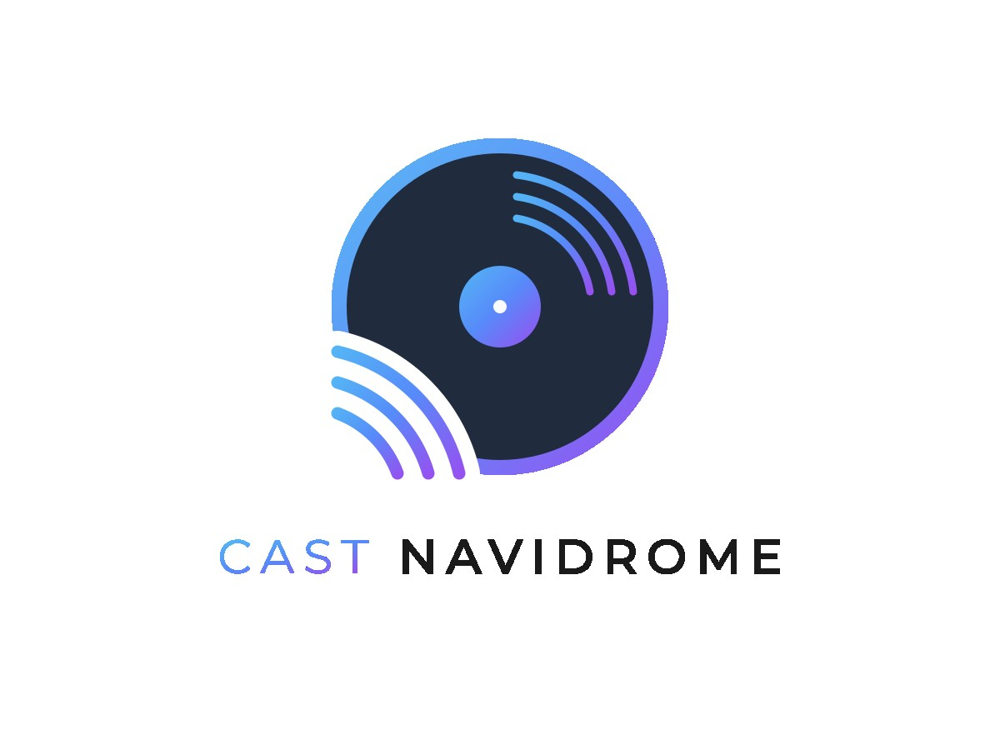

<div align="center"></div>

# castNavidrome

castNavidrome turns every Alexa device into its own UPnP/DLNA media renderer, so DLNA clients (Symfonium, Supersonic, …) can cast music to individual Echoes. It also bridges Alexa devices to a Subsonic API compatible media server (for example Navidrome) for voice-controlled playback of your own music collection.

<div align="center"></div>

**castNavidrome is a fork of [AskNavidrome](https://github.com/rosskouk/asknavidrome)** (Ross Stewart, MIT License) with local extensions from several community forks plus a built-in UPnP MediaRenderer for every Alexa device. See [Fork of AskNavidrome](#fork-of-asknavidrome) and [CREDITS.md](CREDITS.md).

## Highlights

- **UPnP/DLNA MediaRenderer:** every selected Alexa device appears as its own renderer in Navidrome, so DLNA clients (Symfonium, Supersonic, …) can send tracks to individual Echoes.
- Play music by artist, album, song, genre, playlist, decade, or free-text query.
- Shuffle the play queue, star/unstar songs, show details of the current track.
- Radio streams and playlist discovery ("play more playlists like this", "find a playlist").
- Help topics and spoken answers in the language of the Echo device.
- On Echo Show devices, the cover of the current album is shown during playback.
- Optional Amazon OAuth 2.0 / Login with Amazon authentication (recommended, replaces manual cookie copying and TOTP login).
- Runs directly with Python or in a Docker container (recommended).

## Languages

This README: English.
- [`README.de.md`](README.de.md) — Deutsch
- [`README.es.md`](README.es.md) — Español

Interaction models for the Alexa Developer Console are in [`alexa/`](alexa) for `de-DE`, `en-US`, `es-ES`, `fr-FR`, `it-IT`, `pt-BR`. (AI-Translated)

## Fork of AskNavidrome

castNavidrome is a fork of [rosskouk/asknavidrome](https://github.com/rosskouk/asknavidrome). The upstream features (Subsonic API access, Alexa skill handler, MediaQueue, scrobbling, multi-threading for large playlists) originate from Ross Stewart.

Additional features were adopted from community forks of AskNavidrome (all MIT licensed) and from local development. The exact origin of every feature, the author, the fork and the local changes are documented in [CREDITS.md](CREDITS.md).

Local features without an upstream template:

- `skill/castnavidrome/upnp/` — own UPnP MediaRenderer (SSDP, Description, SOAP, DIDL) per Alexa device.
- `skill/castnavidrome/renderer_host.py` — renderer host process, device filter, UUID persistence.
- `skill/castnavidrome/renderer_registry.py` — stable mapping Alexa device → UPnP UUID (`ownerId` + `serialNumber`).
- `skill/castnavidrome/alexa_device_filter.py` — device selection by type, name, regex and online status.
- `skill/castnavidrome/alexa_remote.py` — text commands to Echo devices, device list via the Amazon devices API.
- `skill/castnavidrome/localization.py` — localized skill responses and language-specific voice commands.
- `alexa/` — interaction models, one file per language.

The software is distributed under the [MIT License](LICENSE). The original copyright notice of Ross Stewart is preserved; local modifications are copyrighted by the castNavidrome contributors (see `CREDITS.md` and `LICENSE`).

## Requirements

- A digital music collection served by a Subsonic API compatible media server (tested with Navidrome).
- The media server must be reachable over HTTPS with a valid TLS certificate (Amazon requires this for streaming).
- An Amazon Echo device whose locale matches the skill locale.
- An Alexa skill created in the [Amazon Alexa Developer Console](https://developer.amazon.com/alexa/console/ask), with the Audio Player interface enabled and the HTTPS endpoint pointing to this web service.
- (Optional, for the media renderers) port `1900/udp` available for SSDP discovery and the container able to use the host network or a macvlan.
- A Client with support for DLNA Casting (Tested with Symfonium on Android (best discovery), Jellybox, Feishin, Supersonic on Windows (okay discovery), Resonus and Yuzic on Android (janky discovery)).

## Installation

### Option 1: Docker Compose (recommended)

1. Copy the example configuration:
   ```bash
   cp .env.example .env
   ```
2. Edit `.env` and fill in your own values (Navidrome URL, user, password, skill ID, …).  
   `.env` is **not** committed to version control.
3. Start everything:
   ```bash
   docker compose up -d --build
   ```

Example `docker-compose.yml`:

```yaml
services:
  castnavidrome:
    container_name: castnavidrome
    build:
      context: .
      dockerfile: Dockerfile
    image: castnavidrome:local
    environment:
      - NAVI_SKILL_ID=${NAVI_SKILL_ID}
      - NAVI_URL=${NAVI_URL}
      - NAVI_BASE_URL=${NAVI_BASE_URL}
      - NAVI_USER=${NAVI_USER}
      - NAVI_PASS=${NAVI_PASS}
      - NAVI_ALEXA_API_KEY=${NAVI_ALEXA_API_KEY}
      - NAVI_ALEXA_COOKIE_FILE=/run/secrets/alexa.cookies
      - NAVI_AMAZON_SESSION_FILE=/var/lib/castnavidrome/amazon_session.json
    volumes:
      - ./.secrets/alexa.cookies:/run/secrets/alexa.cookies:ro
      - ./state:/var/lib/castnavidrome
    logging:
      driver: "json-file"
      options:
        max-size: "10m"
        max-file: "1"
    depends_on:
      tailscale:
        condition: service_healthy
    restart: unless-stopped

  # Optional: exposes every selected Alexa device as its own UPnP media renderer.
  # Requires the host network so SSDP (port 1900/udp) works for discovery.
  castnavidrome-renderer:
    build:
      context: .
      dockerfile: Dockerfile
    image: castnavidrome:local
    container_name: castnavidrome-renderer
    network_mode: host
    command: ["python3", "-m", "castnavidrome.renderer_host"]
    environment:
      - NAVI_ALEXA_COOKIE_FILE=/run/secrets/alexa.cookies
    volumes:
      - ./.secrets/alexa.cookies:/run/secrets/alexa.cookies:ro
      - ./state:/var/lib/castnavidrome
    restart: unless-stopped

  tailscale:
    image: tailscale/tailscale:latest
    container_name: tailscale-${SERVICE}
    hostname: ${SERVICE}
    environment:
      - TS_AUTHKEY=${TS_AUTHKEY}
      - TS_STATE_DIR=/var/lib/tailscale
      - TS_SERVE_CONFIG=/config/serve.json
      - TS_USERSPACE=false
      - TS_ENABLE_HEALTH_CHECK=true
      - TS_LOCAL_ADDR_PORT=127.0.0.1:41234
      - TS_AUTH_ONCE=true
    volumes:
      - ./config:/config
      - ./ts/state:/var/lib/tailscale
    devices:
      - /dev/net/tun:/dev/net/tun
    cap_add:
      - net_admin
    ports:
      - 0.0.0.0:${SERVICEPORT}:${SERVICEPORT}
    healthcheck:
      test: ["CMD", "wget", "--spider", "-q", "http://127.0.0.1:41234/healthz"]
      interval: 1m
      timeout: 10s
      retries: 3
      start_period: 10s
    restart: unless-stopped
```

Only the required variables and fixed paths are in the compose file. Every other setting has a sensible default in the code and can be added to `.env` when you need to change it (see [Configuration](#configuration)). The cookie file (`.secrets/alexa.cookies`) and the state directory (`state/`) are local only and are excluded from version control via `.gitignore`.

### Which variables are required?

castNavidrome splits its configuration into **required** and **optional** environment variables:

- **Required** — the service refuses to start and prints a clear error in the log when one is missing. They are read from the environment or from Docker secrets.
- **Optional** — when the variable is not set, the code uses a sensible default. When it is set (for example via `docker-compose.yaml` or a Docker secret), the set value takes precedence over the default.

The `docker-compose.yaml` below therefore only contains the required variables plus the optional ones that you want to override. Every optional entry carries a `${VAR:-default}` fallback so that the container still receives a value when the variable is missing from `.env`.

### Option 2: Run directly with Python

```bash
cd skill
python3 -m venv .venv
source .venv/bin/activate
pip install -r requirements-full.txt

NAVI_SKILL_ID=<your-skill-id> \
NAVI_URL=https://your-navidrome.test \
NAVI_USER=<username> \
NAVI_PASS=<password> \
NAVI_PORT=443 \
NAVI_API_PATH=/rest \
NAVI_API_VER=1.16.1 \
python3 app.py
```

See [Configuration](#configuration) for all environment variables.

## Alexa skill setup

1. Create a custom skill in the [Alexa Developer Console](https://developer.amazon.com/alexa/console/ask).
2. Set the primary locale to the locale of your Echo device (this must match).
3. Upload one of the interaction models from [`alexa/`](alexa) into the *Interaction Model → JSON Editor* (for example `alexa/en-US.json`) and save the model.
4. Add your playlist names to the `playlist_names` slot type.
5. Enable the *Audio Player* interface under *Interfaces*.
6. Set the endpoint to the HTTPS URL of this web service (default region) and save.
7. Build the model and add the skill to your Echo devices as a development skill.

### Skill ID

The `NAVI_SKILL_ID` is the unique identifier of your Alexa skill. You find it in the [Amazon Alexa Developer Console](https://developer.amazon.com/alexa/console/ask):

1. Open your skill in the Developer Console.
2. Go to **Skill → Information** (or the **Usage** tab in some consoles).
3. Copy the **Skill ID** (looks like `amzn1.ask.skill.xxxxxxxx-…`).
4. Set it as `NAVI_SKILL_ID` in your `.env`.

If `NAVI_SKILL_ID` is not set, the web service responds to any skill request.

### External URL with Tailscale Funnel

For Alexa to reach your skill and for Navidrome to stream covers, both need a public HTTPS URL. You can create one with [Tailscale Funnel](https://tailscale.com/kb/1216/funnel) without opening ports on your router:

1. Install Tailscale on the host running castNavidrome and Navidrome.
2. Expose the castNavidrome web service:
   ```bash
   tailscale funnel on 443
   ```
   (or the port your container listens on, for example `8000`).
3. Expose Navidrome the same way if it is not already reachable from the internet:
   ```bash
   tailscale funnel on 443
   ```
4. Tailscale gives you a DNS name like `yourdevice.tailxxxxyyyy.ts.net`. Use it as:
   - `NAVI_URL` — the Navidrome server URL, for example `https://yourdevice.tailxxxxyyyy.ts.net`
   - `NAVI_BASE_URL` — the public URL of this skill, for example `https://yourdevice.tailxxxxyyyy.ts.net`
   - The HTTPS endpoint in the Alexa Developer Console, pointing to your castNavidrome service.

Tailscale Funnel terminates TLS at the Tailscale edge, so Alexa's HTTPS requirement is satisfied without you managing certificates.

### Alternative: Tailscale as a sidecar container

If you do not want to install Tailscale on the host, run it as a sidecar container instead. castNavidrome then shares the Tailscale container's network namespace (`network_mode: service:tailscale`), so it is reachable over the Tailscale Funnel address without host-level Tailscale.

Add a `tailscale` service to your `docker-compose.yml`:

```yaml
services:
  tailscale:
    image: tailscale/tailscale:latest
    container_name: tailscale
    environment:
      - TS_AUTHKEY=${TS_AUTHKEY}
    cap_add:
      - NET_ADMIN
    volumes:
      - tailscale-state:/var/lib/tailscale
    restart: unless-stopped

  castnavidrome:
    container_name: castnavidrome
    build:
      context: .
      dockerfile: Dockerfile
    image: castnavidrome:local
    network_mode: service:tailscale
    environment:
      - NAVI_SKILL_ID=${NAVI_SKILL_ID}
      - NAVI_URL=https://yourdevice.tailxxxxyyyy.ts.net
      - NAVI_BASE_URL=https://yourdevice.tailxxxxyyyy.ts.net
      - NAVI_USER=${NAVI_USER}
      - NAVI_PASS=${NAVI_PASS}
      - NAVI_PORT=443
      - NAVI_API_PATH=/rest
      - NAVI_API_VER=1.16.1
      - NAVI_SONG_COUNT=50
      - NAVI_DEBUG=0
      - NAVI_ALEXA_API_KEY=${NAVI_ALEXA_API_KEY}
      - NAVI_ALEXA_DOMAIN=${NAVI_ALEXA_DOMAIN:-amazon.com}
      - NAVI_ALEXA_LOCALE=${NAVI_ALEXA_LOCALE:-en-US}
      - NAVI_ALEXA_SKILL_NAME=${NAVI_ALEXA_SKILL_NAME:-castnavidrome}
      - NAVI_ALEXA_COOKIE_FILE=/run/secrets/alexa.cookies
      - NAVI_AMAZON_CLIENT_ID=${NAVI_AMAZON_CLIENT_ID:-}
      - NAVI_AMAZON_CLIENT_SECRET=${NAVI_AMAZON_CLIENT_SECRET:-}
      - NAVI_AMAZON_REDIRECT_URI=${NAVI_AMAZON_REDIRECT_URI:-}
      - NAVI_AMAZON_TOKEN_FILE=/var/lib/castnavidrome/amazon_oauth_token.json
    volumes:
      - ./.secrets/alexa.cookies:/run/secrets/alexa.cookies:ro
      - ./state:/var/lib/castnavidrome
    restart: unless-stopped

volumes:
  tailscale-state:
```

Authorize the Tailscale device (via the Tailscale admin console or `docker exec tailscale tailscale up --authkey=...`), then enable Funnel:

```bash
docker exec tailscale tailscale funnel on 443
```

The rest of the configuration (`NAVI_URL`, `NAVI_BASE_URL`, Alexa endpoint) stays the same as in the host-based approach above.

The invocation name is the same in every locale and is set with `NAVI_ALEXA_SKILL_NAME`.

**Tip:** Choose an invocation name that has nothing to do with a music service (not "Spotify", "Apple Music", "Amazon Music", "Navidrome", …). Otherwise Alexa may try to route your request to another music skill instead of castNavidrome, and your own music collection will not be played.

## Docker image build

```bash
docker build -t castnavidrome:local .
```

Multi-architecture images can be built with `docker buildx` when required (the Dockerfile targets `alpine:3.19`). The image is not published automatically; build and push it to your own registry before releasing.

## Configuration

The service reads its configuration from environment variables.

### Required

| Variable | Description | Example |
|---|---|---|
| `NAVI_SKILL_ID` | ID of your Alexa skill (limits the web service to your skill) | `amzn1.ask.skill.xxxxxxxx-…` |
| `NAVI_URL` | URL of the Subsonic API server (`https://`, no trailing slash) | `https://navidrome.example.test` |
| `NAVI_USER` | Navidrome user name | `bob` |
| `NAVI_PASS` | Navidrome password | — |
| `NAVI_PORT` | Port of the Subsonic API server | `443` |
| `NAVI_API_PATH` | Subsonic API path | `/rest` |
| `NAVI_API_VER` | Subsonic API version | `1.16.1` |
| `NAVI_SONG_COUNT` | Minimum number of songs for random/genre/artist playlists | `50` |

### Optional

| Variable | Description | Example |
|---|---|---|
| `NAVI_BASE_URL` | Public URL of this skill (used for cover art on Alexa cards) | `https://castnavidrome.example.test` |
| `NAVI_DEBUG` | Debug level (0–3) | `0` |
| `NAVI_DEBUG_TOKEN` | Token protecting the `/debug/*` endpoints | — |
| `NAVI_ALEXA_API_KEY` | API key sent in `X-API-Key` for `/api/alexa/*`. Generate it yourself, for example with `openssl rand -hex 32`. | `openssl rand -hex 32` |
| `NAVI_ALEXA_DOMAIN` | Amazon domain | `amazon.com` |
| `NAVI_ALEXA_LOCALE` | Locale of the skill answers and voice commands | `en-US` |
| `NAVI_ALEXA_SKILL_NAME` | Invocation name of the skill | `castnavidrome` |
| `NAVI_ALEXA_COOKIE_FILE` | Path to an Alexa cookie file (cookie fallback) | `/run/secrets/alexa.cookies` |
| `NAVI_AMAZON_CLIENT_ID` / `NAVI_AMAZON_CLIENT_SECRET` / `NAVI_AMAZON_REDIRECT_URI` | Amazon OAuth 2.0 / Login with Amazon | `amzn1.application-oa2-client.xxx` / `secret` / `https://...` |
| `NAVI_AMAZON_SESSION_FILE` | Persisted Amazon session cookies | `/var/lib/castnavidrome/amazon_session.json` |
| `NAVI_RADIO_URL` / `NAVI_RADIO_STATIONS_URL` | Radio stream URLs | — |
| `NAVI_PLAYLIST_NAME_PATTERN` / `_SPOKEN_FORMAT` / `_QUALIFIED_FORMAT` | Playlist name grouping and spoken format | — |
| `NAVI_LOG_LEVEL` | Log level (`DEBUG`, `INFO`, `WARNING`, `ERROR`) | `INFO` |
| `NAVI_API_TIMEOUT` | Timeout in seconds for Navidrome API requests | `10` |

### Media renderer (`castnavidrome-renderer`)

| Variable | Description | Example |
|---|---|---|
| `NAVI_ALEXA_RENDERER_ENABLED` | Enable the renderers | `yes` |
| `NAVI_ALEXA_RENDERER_PORT` | UPnP description/control port | `49443` |
| `NAVI_ALEXA_RENDERER_ANNOUNCE` | Which tracks are announced: `explicit`, `always`, `never` | `explicit` |
| `NAVI_ALEXA_RENDERER_ANNOUNCE_INTERVAL` | Seconds between periodic SSDP `ssdp:alive` announcements | `720` |
| `NAVI_ALEXA_RENDERER_STATE_FILE` | Registry mapping Alexa devices → renderer UUIDs | `/var/lib/castnavidrome/renderer-devices.json` |
| `NAVI_ALEXA_RENDERER_NAME_PREFIX` | Prefix for renderer names | — |
| `NAVI_ALEXA_RENDERER_DEVICE_TYPES` | Allowed device types (comma separated) | `ECHO,FIRE_TV` |
| `NAVI_ALEXA_RENDERER_NAME_REGEX` | Regex device names must match | `^Echo` |
| `NAVI_ALEXA_RENDERER_DISABLE_REFRESH` | Disable periodic device refresh (default: only once at container start) | `true` |
| `NAVI_ALEXA_RENDERER_DISABLE_BYEBYE` | Disable SSDP `ssdp:byebye` announcements on stop or when removing renderers | `false` |
| `NAVI_ALEXA_RENDERER_CLIENT_TIMEOUT` | Seconds of client inactivity after which playback stops (`0` = disabled) | `0` |
| `NAVI_ALEXA_RENDERER_DISABLE_ANNOUNCE` | Disable periodic SSDP announcements (`true`/`false`) | `false` |
| `NAVI_ALEXA_RENDERER_ANNOUNCE_INTERVAL` | Seconds between periodic SSDP announcements (`<= 0` disables the loop) | `720` |
| `NAVI_ALEXA_RENDERER_NOTIFY_COUNT` | Number of times `ssdp:alive`/`ssdp:byebye` are repeated (`0` = no repeats) | `3` |
| `NAVI_ALEXA_RENDERER_NOTIFY_DELAY` | Seconds between SSDP notify repetitions (`0` = no delay) | `0.4` |
| `NAVI_ALEXA_RENDERER_ONLY_ONLINE` | Expose only online devices | `no` |
| `NAVI_ALEXA_RENDERER_LOG_LEVEL` | Log level | `INFO` |

See `CREDITS.md` for the announcement modes (`explicit` = default: user-started tracks are announced, renderer-started tracks play silently).

## Changes compared to AskNavidrome

castNavidrome keeps the upstream AskNavidrome behaviour intact and adds:

- UPnP MediaRenderer per Alexa device (new containers/process, host networking).
- Localization into six languages with language-specific voice commands.
- Free-text search (`castNavidromePlaySearch`), music by decade, song by title, playlist discovery, radio streams, help topics.
- Amazon OAuth 2.0 / Login with Amazon (`skill/castnavidrome/amazon_oauth.py`).
- Protected debug endpoints (`NAVI_DEBUG_TOKEN`) and no session tokens / stream URIs in logs or the debug table.

Every adopted feature and its origin is listed in [CREDITS.md](CREDITS.md) with the local changes applied.

### Amazon OAuth 2.0 / Login with Amazon (recommended)

This is the stable, long-term login method. Amazon's regular sign-in page (`/ap/signin`) no longer works reliably, so castNavidrome uses the official OAuth 2.0 Authorization Code flow instead — the same way Home Assistant Skills do.

#### A. Create a Login with Amazon Security Profile

1. Open the [Login with Amazon Console](https://developer.amazon.com/loginwithamazon/console/site/lwa/overview.html) and sign in with your Amazon developer account.
2. Click **Create a New Security Profile** (or select an existing profile).
3. Enter a name (e.g. `castNavidrome`) and a description, then click **Save**.
4. Copy the displayed values:
   - **Client ID** (begins with `amzn1.application-oa2-client.`)
   - **Client Secret**

#### B. Register the Redirect URI in the Amazon Developer Console

For Amazon to accept the OAuth callback, the Redirect URI must be entered exactly in the Security Profile:

1. In the Login with Amazon Console: open your Security Profile → tab **Web Settings**.
2. Under **Allowed Return URLs** add the following entry:

   ```
   https://your-castnavidrome-domain.test/api/alexa/amazon/callback
   ```

   Replace `your-castnavidrome-domain.test` with your public castNavidrome domain (e.g. `https://castnavidrome.drake-aldebaran.ts.net`).
3. Click **Save**.

> **Important:** The Redirect URI must exactly match `NAVI_AMAZON_REDIRECT_URI` in your `.env`. Any trailing slash (if present) must be identical as well.

#### C. Set environment variables in `.env`

Enter the values from step A into your `.env`:

```env
# Amazon OAuth (Login with Amazon) — recommended authentication method
NAVI_AMAZON_CLIENT_ID=amzn1.application-oa2-client.your-client-id
NAVI_AMAZON_CLIENT_SECRET=your-client-secret
NAVI_AMAZON_REDIRECT_URI=https://your-castnavidrome-domain.test/api/alexa/amazon/callback
NAVI_AMAZON_TOKEN_FILE=/var/lib/castnavidrome/amazon_oauth_token.json
```

You also need `NAVI_ALEXA_DOMAIN` to select which Amazon marketplace to use:

```env
# Amazon marketplace for login (amazon.de, amazon.com, amazon.co.uk, …)
NAVI_ALEXA_DOMAIN=amazon.com
```

| Variable | Meaning |
|----------|---------|
| `NAVI_AMAZON_CLIENT_ID` | Client ID from the LWA Security Profile |
| `NAVI_AMAZON_CLIENT_SECRET` | Client Secret from the LWA Security Profile |
| `NAVI_AMAZON_REDIRECT_URI` | Must be entered exactly under "Allowed Return URLs" in the Amazon Developer Console |
| `NAVI_AMAZON_TOKEN_FILE` | Path where OAuth tokens are stored (default: `/var/lib/castnavidrome/amazon_oauth_token.json`) |
| `NAVI_ALEXA_DOMAIN` | Amazon marketplace, e.g. `amazon.de` for German accounts, `amazon.com` for US accounts |

#### D. Start containers and initialize OAuth tokens

1. Build and start the containers:

   ```bash
   docker compose up -d --build
   ```

   The OAuth variables are automatically passed to both containers (`castnavidrome` and `castnavidrome-renderer`).

2. Open the login URL in your browser:

   ```
   https://your-castnavidrome-domain.test/api/alexa/amazon/login
   ```

3. Sign in with your Amazon account and grant castNavidrome permission to access your Alexa devices.
4. You will be redirected back to castNavidrome, and the access tokens will be stored in `amazon_oauth_token.json`.
5. From now on the Alexa API works automatically; expired tokens are refreshed in the background.

#### E. Startup check

When the main container starts, it checks whether valid OAuth tokens are present. If not, a warning appears in the log:

```
No valid Amazon OAuth tokens found. Open /api/alexa/amazon/login to authenticate before using the Alexa API.
```

This is normal after the first start — create the tokens by calling `/api/alexa/amazon/login`.

#### F. Cookie file as fallback

If the OAuth login does not work (e.g. due to CAPTCHA or additional verification steps), a static Alexa cookie file can still be used as a fallback (see section "Alexa Cookie File (manual fallback)" below).

If something goes wrong, you can still fall back to the manual cookie file below.

### Alexa Cookie File (manual fallback)

If you prefer not to use the automatic Amazon login (or it fails because of CAPTCHA or an extra verification step), you can provide an existing Alexa session cookie file instead.

1. Open your Amazon domain (for example https://www.amazon.de) in the browser and sign in.
2. Open the Developer Tools (F12), go to **Application → Cookies** and select your Amazon domain.
3. Copy the cookies as `name=value` pairs, one per line. Make sure the `csrf` cookie is included.
4. Save the file as `.secrets/alexa.cookies` (or any path you like) and set `NAVI_ALEXA_COOKIE_FILE` to that path.
5. Mount the file read-only into the container (see the `docker-compose.yml` example).


## Security
- The Alexa cookie file and any `NAVI_AMAZON_CLIENT_SECRET` are sensitive. Keep `.secrets/` and `.env` out of version control (they are in `.gitignore`) and mount `.secrets/` read-only.
- Do not expose the `/api/alexa/*` or `/debug/*` endpoints to the public internet without `NAVI_ALEXA_API_KEY` and HTTPS.

## License

MIT License. Copyright (c) 2022 Ross Stewart; local modifications copyright (c) 2026 castNavidrome contributors. See [LICENSE](LICENSE) and [CREDITS.md](CREDITS.md).

## Disclaimer

This project is vibe coded: it was assembled quickly with AI assistance and has not undergone a thorough security or code review. Treat it as a starting point, not production-ready software. Secrets and personal data are excluded from version control via `.gitignore`, but you are responsible for reviewing and validating anything you run.
