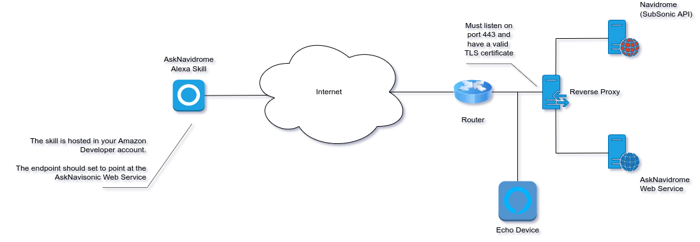

.. castNavidrome documentation master file, created by
   sphinx-quickstart on Sat Jul  2 13:52:30 2022.
   You can adapt this file completely to your liking, but it should at least
   contain the root `toctree` directive.

**castNavidrome Alexa Skill Documentation**
===========================================

**castNavidrome** is an Alexa skill which allows you to play music hosted on a SubSonic API compatible media server, like Navidrome.

This allows to you stream your own music collection to your Echo devices without the restrictions you would normally face with regular 
streaming services like Amazon Music or Spotify.  castNavidrome allows you to:

- Skip backwards and forwards in your current queue or playlist without limitation.
- Avoid paying subscription costs.
- Avoid being forced to listen to adverts at regular intervals.
- Actually use the music collection you have already paid for!
- Run the service on a PC directly or inside a Docker container.

This skill was inspired by `AskSonic <https://github.com/srichter/asksonic>`_, however AskSonic was missing two features I required,
the ability to play playlists and the ability to play an individual song.  Instead of contributing to that project I have opted to
create a new skill based on the **Alexa Skills Kit SDK for Python** as this has been updated more recently than *flask-ask* which is used 
by AskSonic, castNavidrome is not a replacement for AskSonic and it does not implement all of AskSonic's features, it is however a viable
alternative for those that would like a simple skill to let you stream your own music collection.

.. warning:: 
   The skill requires a username and password for your Navidrome installation which is stored in clear text.  As the web service needs to be 
   publicly accessible there is a chance that this password could be compromised.  Please do not use an administrative account for your 
   Navidrome installation or a password that you use on any other service.  This software is distributed under the MIT license and no warranty
   is provided.

Requirements
************

In order to use castNavidrome you will need:

**Your Music Collection**

Your collection needs to have been converted to a digital format like MP3.  There are many tutorials available on the web to help you do this, but do 
be aware that there are limitations on the types of files that Echo devices can stream. You should review these before converting your collection as if
you do not meet the requirements they will need to be transcoded before your Echo device can stream them. This article explains `Amazon's
Audio Stream Requirements <https://developer.amazon.com/en-US/docs/alexa/custom-skills/audioplayer-interface-reference.html#audio-stream-requirements>`_

**A SubSonic API Compatible Media Server**

I use Navidrome, but you can use any flavour of SubSonic that you like.  For information on getting and setting up Navidrome
check out their website `Navidrome <https://www.navidrome.org/>`_.  Your media server must be available on port 443 and serve requests using
https with a valid TLS certificate, these are requirements dictated by Amazon and you must meet them or you will be unable to stream your collection.
The media server needs to be publicly accessible from the Internet, in addition to allowing you to use this skill you will then be able to use any
SubSonic API compatible mobile app to listen to your collection too.

You can get free TLS certificates from `Let's Encrypt <https://letsencrypt.org/>`_

You can set up dynamic DNS to make your media server accessible for free with `afraid.org <https://freedns.afraid.org/>`_

**Tags**

This may seem obvious but you need to make sure that your collection is accurately tagged with information like the artist, title, track number etc.
as this is the only way that your media server can identify the music in your collection.  If you need a tool to help with this have a look at
`MusicBrainz Picard <https://picard.musicbrainz.org/>`_.

**An Amazon Echo Device**

You need something to listen to your music on!

About the castNavidrome Skill
*****************************

The skill consists of two parts, the actual Alexa skill and the web service service which allows the skill to connect to your SubSonic API 
compatible media server.  The web service needs to have a valid TLS certificate, the easiest way to enable this is to run the web service
behind a reverse proxy, the web service also needs to be publicly accessible on the Internet to allow the Alexa skill to access the service.

Supported Intents
*****************

+-----------------------------------------------+--------------------------------------------+-------------------------------------+
| Intent Name                                   | Description                                | Example                             |
+===============================================+============================================+=====================================+
| :class:`~app.castNavidromePlayMusicByArtist`  | Play music by a specific artist            | Play Where is my Mind by The Pixies |
+-----------------------------------------------+--------------------------------------------+-------------------------------------+
| :class:`~app.castNavidromePlayAlbumByArtist`  | Play a specific album by a specific artist | Play The Blue Album by The Beatles  |
+-----------------------------------------------+--------------------------------------------+-------------------------------------+
| :class:`~app.castNavidromePlaySongByArtist`   | Play a specific song by a specific artist  | Play the song Help by The Beatles   |
+-----------------------------------------------+--------------------------------------------+-------------------------------------+
| :class:`~app.castNavidromePlayPlaylist`       | Play a playlist                            | Play the playlist work music        |
+-----------------------------------------------+--------------------------------------------+-------------------------------------+
| :class:`~app.castNavidromePlayMusicByGenre`   | Play music with a specific genre           | Play jazz music                     |
+-----------------------------------------------+--------------------------------------------+-------------------------------------+
| :class:`~app.castNavidromePlayMusicRandom`    | Play a random mix of songs                 | Play random songs                   |
+-----------------------------------------------+--------------------------------------------+-------------------------------------+
| :class:`~app.castNavidromePlayFavouriteSongs` | Play your starred / favourite songs        | Play my favourite songs             |
+-----------------------------------------------+--------------------------------------------+-------------------------------------+
| :class:`~app.castNavidromeRandomiseQueue`     | Shuffle / randomise the current play queue | Shuffle the queue                   |
+-----------------------------------------------+--------------------------------------------+-------------------------------------+
| :class:`~app.castNavidromeSongDetails`        | Give details on the playing track          | What is playing                     |
+-----------------------------------------------+--------------------------------------------+-------------------------------------+
| :class:`~app.castNavidromeStarSong`           | Star / favourite a song                    | Star this song                      |
+-----------------------------------------------+--------------------------------------------+-------------------------------------+
| :class:`~app.castNavidromeUnstarSong`         | Unstar / unfavourite a song                | Unstar this song                    |
+-----------------------------------------------+--------------------------------------------+-------------------------------------+
| :class:`~app.castNavidromePlaySearch`         | Play whatever a free text query matches    | Play Highway to Hell                |
+-----------------------------------------------+--------------------------------------------+-------------------------------------+
| :class:`~app.castNavidromePlayMusicByDecade`  | Play the music of a decade                 | Play eighties music                 |
+-----------------------------------------------+--------------------------------------------+-------------------------------------+
| :class:`~app.castNavidromePlaySong`           | Play a song by its title                   | Play Stairway to Heaven             |
+-----------------------------------------------+--------------------------------------------+-------------------------------------+
| :class:`~app.castNavidromeShufflePlaylist`    | Play a playlist in random order            | Shuffle the playlist party          |
+-----------------------------------------------+--------------------------------------------+-------------------------------------+
| :class:`~app.castNavidromePlayRadio`          | Play a radio station                       | Play the radio station pop          |
+-----------------------------------------------+--------------------------------------------+-------------------------------------+
| :class:`~app.castNavidromeListPlaylists`      | List the playlists of the collection       | List my playlists                   |
+-----------------------------------------------+--------------------------------------------+-------------------------------------+
| :class:`~app.castNavidromeHearMorePlaylists`  | Play more playlists of a mood              | Play me more playlists              |
+-----------------------------------------------+--------------------------------------------+-------------------------------------+
| :class:`~app.castNavidromeFindPlaylist`       | Find a playlist by a keyword               | Find the playlist party             |
+-----------------------------------------------+--------------------------------------------+-------------------------------------+
| :class:`~app.castNavidromeHelpTopic`          | Explain a topic of the skill               | Help me with playlists              |
+-----------------------------------------------+--------------------------------------------+-------------------------------------+

The following control intents are also supported:

- :class:`Next / Skip <app.NextPlaybackHandler>`
- :class:`Previous / Back <app.PreviousPlaybackHandler>`
- :class:`Pause <app.PausePlaybackHandler>`
- :class:`Resume <app.ResumePlaybackHandler>`

Due to the way that Alexa skills operate there are some limitations.  Full music Alexa skills require a catalog of content to be provided and this defeats
the purpose of being able to search and stream from your own server directly.  Because of this a custom skill type is used along with the AudioPlayer interface,
but this has some limitations in how the skill is invoked.

The following voice commands should be successful (thanks to Raul824)

- Alexa ask Navisonic What is Playing?
- Alexa ask Navisonic to star this song.
- Alexa ask Navisonic to unstar this song.
- Alexa ask Navisonic to play rock music
- Alexa ask Navisonic to play playlist "Playlist Name"

If you have any problems with these, you can open the skill manually with *Alexa, open Navisonic*. Similarly this can be done when a track is playing, for example
if you want to get information on the track that is playing you will need to invoke the skill and call the intent by saying the following while the track is playing:

- Alexa, open Navisonic
- What is playing?

Installation and Setup
**********************

Creating the castNavidrome Alexa Skill 
--------------------------------------

#. Login to the Amazon Alexa Skills Kit Builder at https://developer.amazon.com.
   - You must use the same account that is set on your Echo devices.
#. Click *Create Skill*
#. Configure the skill:

   .. image:: resources/create_skill_1.png
      :width: 800
      :align: center
      :alt: Skill Creation Step 1
       

   - Set *Skill name* to the name you wish to use to invoke the skill.  This should be two words or a warning will be raised, I have found that a single word
     still works when testing.  It can be hard to find a good skill name so feel free to experiment!
   - Set *Primary locale* to your locale, this **must** also be the locale set on your Echo device.
     
     .. note:: The locale setting is extremely important, if the skill locale and the locale set on your Echo device do not match the skill will not work.  In
      addition there are no error messages generated making the issue quite difficult to troubleshoot.  The locale on your Echo device can be set via the Alexa Android
      app.  Please do check the locale setting if you have trouble setting up the skill as the Alexa Skill Builder will default to your local locale, but Echo devices
      are set to the US locale by default.  Checking this first will save you a few hours of troubleshooting!

   - Set sync locales to *No*
   - Choose *Custom* as the model.
   - Choose *Provision your own* as the hosting method for backend resources.
   - Click *Create skill* again

#. Choose the template

   .. image:: resources/create_skill_2.png
      :width: 800
      :align: center
      :alt: Skill Creation Step 2

   - Choose *Start from Scratch*
   - Click *Continue with template* and wait while the skill is created.

#. Upload the intents

   .. image:: resources/create_skill_3.png
      :width: 800
      :align: center
      :alt: Skill Creation Step 3

   - Click *Interaction Model*, then *JSON Editor*
   - Delete everything that is currently in the editor and paste in the contents of **alexa/de-DE.json**
   - Click *Save Model*

#. Configure playlists

   To be able to play your playlists you must add the name of each playlist to the *playlist_names* slot type.  
   You will need to maintain the list and add additional playlist names as you create them to allow them to
   be played via the AskNavisonic skill.

   .. image:: resources/create_skill_4.png
      :width: 800
      :align: center
      :alt: Skill Creation Step 4

   - Click *Slot Types*.
   - Click *playlist_names*.
   - Add and remove names as required.
   - Click the *Save Model* button when you are done.

#. Enable the Audio Player interface

   .. image:: resources/create_skill_5.png
      :width: 800
      :align: center
      :alt: Skill Creation Step 5

   - Click *Interfaces*, enable *Audio Player*, then click *Save Interfaces*

#. Set the endpoint

   The skill's endpoint is the location of the castNavidrome web service.

   .. image:: resources/create_skill_6.png
      :width: 800
      :align: center
      :alt: Skill Creation Step 6

   - Click *Endpoint*
   - Select *HTTPS*
   - Enter the the URL to the web service in the *Default Region* box.
   - Select the SSL certificate type.  This will depend on your setup, if you are using Let's Encrypt
     choose *My development endpoints has a certificate from a trusted certificate authority*
   - Click *Save Endpoints*

   .. TIP:: There are three options to pick from when setting the SSL certificate type in the Amazon Developer portal.  
      To confirm that you are using the correct option browse to the URL of your castNavidrome skill, you will see a message similar to *405 Method Not Allowed*, this is normal.
      View the certificate in use by the skill in your browser and look at the **Common Name (CN)** field.  If this contains a **\*** for example **\*.ngrok-free.app** then you
      are using a wildcard certificate.  If the common name does not contain a **\*** then you have a regular certificate. 
      
      - My development endpoint is a sub-domain of a domain that has a wildcard certificate from a certificate authority
         - Use this if your skill uses a wildcard certificate with a **\***
      - My development endpoint has a certificate from a trusted certificate authority
         - Use this if you have a regular certificate
      - I will upload a self-signed certificate in X509 format
         - Do not select this option unless you know what you are doing.
      

#. Build the skill

   .. image:: resources/create_skill_7.png
      :width: 800
      :align: center
      :alt: Skill Creation Step 7

   - Click *Invocations*, *Skill Invocation Name*.
   - Click *Save Model*.
   - Click *Build Model*, the process will take a few minutes.

#. Add the skill to your Echo devices.

   The skill you just created should now be available as a development skill in your Alexa app, you can add the development skill to your
   Echo devices.

   .. warning:: It is important that you **do not** publish the skill.  If you do anyone that uses the skill will be able to stream your music
      collection, it may also be possible for credentials to be retrieved.
   

Deploying the castNavidrome Web Service
---------------------------------------

The castNavidrome Web Service is written in Python and can be run directly on a PC with a Python installation, or as a Docker container (recommended).  
Whichever method you use, the service and your Navidrome installation must be available via HTTPS with a well known certificate.  One of the easiest 
ways to implement this is with a reverse proxy.  There are several 
available for free:

* `Caddy <https://caddyserver.com/>`_.
* `Apache <https://httpd.apache.org/docs/2.4/howto/reverse_proxy.html/>`_.
* `Nginx <https://docs.nginx.com/nginx/admin-guide/web-server/reverse-proxy/>`_.

Run on your PC
~~~~~~~~~~~~~~

Please remember that the web service needs to be publicly accessible, if you are running it directly on your PC this means your PC is publicly
accessible.

#. Install Python 3
      * `python3.org <https://www.python.org/downloads/>`_
#. Install git tools
      * `git-scm.com <https://git-scm.com/book/en/v2/Getting-Started-Installing-Git>`_
#. Create a directory for the web service
#. Change to the directory and clone the repository from GitHub

   .. code-block:: bash

      cd directory
      git clone https://github.com/rosskouk/asknavidrome.git

#. Change directory to the skill folder

   .. code-block:: bash
     
      cd castnavidrome/skill

#. Start the skill by setting the required environment variables and executing the application
   you can find details of what each option does in the *configuration* section.

   .. code-block:: bash

      NAVI_SKILL_ID=<your-skill-id> \
      NAVI_SONG_COUNT=50 \
      NAVI_URL=https://your-navidrome-server.test \
      NAVI_USER=<username> \
      NAVI_PASS=<password> \
      NAVI_PORT=443 \
      NAVI_API_PATH=/rest \
      NAVI_API_VER=1.16.1 \
      NAVI_DEBUG=0 \
      python3 app.py

Run inside a Docker container
~~~~~~~~~~~~~~~~~~~~~~~~~~~~~

A Dockerfile has been provided and a prebuilt container is hosted on github.com. **Please note that the prebuilt container was created on an amd64 platform**.  If you
require a different architecture such as arm for a Raspberry Pi, you will need to build a new image using the Dockerfile provided with the repository.

You can configure the service by passing environment variables to the *docker run* command.

.. code-block:: bash
   
   docker run -p 5000:5000 \ 
   -e NAVI_SKILL_ID=<your-skill-id> \
   -e NAVI_SONG_COUNT=50 \
   -e NAVI_URL=https://your-navidrome-server.test \
   -e NAVI_USER=<username> \
   -e NAVI_PASS=<password> \
   -e NAVI_PORT=443 \
   -e NAVI_API_PATH=/rest \
   -e NAVI_API_VER=1.16.1 \
   -e NAVI_DEBUG=0 \
   ghcr.io/rosskouk/asknavidrome:<tag>

If you intent to use the container to build a Kubernetes pod, I have created a side car container which can automatically configure and renew 
TLS certificates with the Kubernetes Nginx Ingress.  `More information <https://github.com/rosskouk/docker-image-k8s-letsencrypt>`_.

Configuration
~~~~~~~~~~~~~

The castNavidrome Web Service reads it's configuration from environment variables and needs the following configuration 
information to run:

+----------------------+----------------------------------------------------------------+------------------------------------------------------+
| Environment Variable | Description                                                    | Example                                              |
+======================+================================================================+======================================================+
| NAVI_SKILL_ID        | The ID of your Alexa skill, this prevents other skills from    | amzn1.ask.skill.xxxxxxxx-xxxx-xxxx-xxxx-xxxxxxxxxxxx |
|                      | connecting to the web service.                                 |                                                      |
+----------------------+----------------------------------------------------------------+------------------------------------------------------+
| NAVI_SONG_COUNT      | The minimum number of songs to add to a playlist.  If playing  | 50                                                   |
|                      | random music, music by genre or music by an artist the web     |                                                      |
|                      | service will ensure the minimum number of tracks added to the  |                                                      |
|                      | queue is at least this value                                   |                                                      |
+----------------------+----------------------------------------------------------------+------------------------------------------------------+
| NAVI_URL             | The URL to the Subsonic API server                             | ``https://navidrome.example.test``                   |
+----------------------+----------------------------------------------------------------+------------------------------------------------------+
| NAVI_USER            | The user name used to connect to the Subsonic API server       | bob                                                  |
+----------------------+----------------------------------------------------------------+------------------------------------------------------+
| NAVI_PASS            | The password used to connect to the Subsonic API server        | ``Sup3rStrongP@ssword``                              |
+----------------------+----------------------------------------------------------------+------------------------------------------------------+
| NAVI_PORT            | The port the Subsonic API server is listening on               | 443                                                  |
+----------------------+----------------------------------------------------------------+------------------------------------------------------+
| NAVI_API_PATH        | The path to the Subsonic API, this should be /rest if you are  | /rest                                                |
|                      | using Navidrome and haven't changed anything                   |                                                      |
+----------------------+----------------------------------------------------------------+------------------------------------------------------+
| NAVI_API_VER         | The version of the Subsonic API in use                         | 1.16.1                                               |
+----------------------+----------------------------------------------------------------+------------------------------------------------------+
| NAVI_DEBUG           | Enable debugging, by setting this variable to 1, or 3.         | 1                                                    |
+----------------------+----------------------------------------------------------------+------------------------------------------------------+

Alexa TextCommand Proof of Concept
----------------------------------

The optional Alexa control API can list devices and send a test command to one online Echo. It uses an existing Alexa session cookie file; it does not store or request an Amazon password.

Configure these additional environment variables:

* ``NAVI_ALEXA_API_KEY``: Required API key sent in the ``X-API-Key`` request header.
* ``NAVI_ALEXA_COOKIE_FILE``: Path inside the service container to a valid Alexa cookie file. Use a read-only mount and keep this file private. The file must contain one ``name=value`` cookie per line, including ``csrf``.
* ``NAVI_ALEXA_DOMAIN``: Amazon domain, defaults to ``amazon.com``.
* ``NAVI_ALEXA_SKILL_NAME``: Skill invocation name, defaults to ``castnavidrome``.
* ``NAVI_ALEXA_LOCALE``: Locale of the TextCommands, defaults to ``en-US``.  It has to be the locale of the Alexa device, because a device only understands a voice command in the language that it is set to.  It is also the locale of the answers of the skill, when the request does not carry one.

The cookie session must already be authenticated and include a current CSRF cookie. Alexa authentication and TextCommand use undocumented internal APIs and may stop working without notice. Do not expose these endpoints to the public internet; use HTTPS or a trusted private network, and do not log cookie contents.

List devices:

.. code-block:: bash

   curl -H "X-API-Key: <your-api-key>" http://localhost:5000/api/alexa/devices

Send the test command to one device by copying its identifiers from the device response:

.. code-block:: bash

   curl -X POST http://localhost:5000/api/alexa/test-play \
     -H "X-API-Key: <your-api-key>" \
     -H "Content-Type: application/json" \
     -d '{"deviceOwnerCustomerId":"<customer-id>","deviceType":"<device-type>","serialNumber":"<serial-number>"}'

The test command asks the selected Echo to play random music through the configured castNavidrome skill.

Alexa Media Renderers
---------------------

The optional media renderer service exposes every selected Alexa device as its own UPnP media renderer.  DLNA
clients (for example Symfonium) can discover the renderers via SSDP, send a track to one of them and the renderer
translates the playback commands into Alexa text commands for the device it belongs to.  Every renderer keeps its
own UUID, so the renderers can be selected individually and stay stable across restarts of the service.

The renderer service is a separate container that needs the host network, because the SSDP discovery uses the
multicast port 1900/udp:

.. code-block:: yaml

   services:
       castnavidrome-renderer:
           build:
               context: .
               dockerfile: Dockerfile
           image: 'castnavidrome:local'
           container_name: castnavidrome-renderer
           network_mode: host
           command: ['python3', '-m', 'castnavidrome.renderer_host']
           environment:
               - 'NAVI_ALEXA_COOKIE_FILE=/run/secrets/alexa.cookies'
               - 'NAVI_ALEXA_DOMAIN=${NAVI_ALEXA_DOMAIN:-amazon.com}'
               - 'NAVI_ALEXA_SKILL_NAME=${NAVI_ALEXA_SKILL_NAME:-castnavidrome}'
               - 'NAVI_ALEXA_LOCALE=${NAVI_ALEXA_LOCALE:-de-DE}'
               - 'NAVI_ALEXA_RENDERER_STATE_FILE=/var/lib/castnavidrome/renderer-devices.json'
           volumes:
               - './.secrets/alexa.cookies:/run/secrets/alexa.cookies:ro'
               - './state:/var/lib/castnavidrome'
           restart: unless-stopped

The renderer reads the same cookie file as the Alexa control API and uses the configured skill name and locale to
build the text commands.  The following environment variables control the renderers:

+-------------------------------------------+-----------------------------------------------------------+--------------------------------------------------+
| Environment Variable                      | Description                                               | Example                                          |
+-------------------------------------------+-----------------------------------------------------------+--------------------------------------------------+
| NAVI_ALEXA_RENDERER_ADVERTISE_HOST        | The IP address that the clients use to reach the          | 192.168.178.128                                  |
|                                           | renderers, detected automatically when empty              |                                                  |
| NAVI_ALEXA_RENDERER_PORT                  | The port of the UPnP description and control endpoints    | 49443                                            |
| NAVI_ALEXA_RENDERER_REFRESH_SECONDS       | How often the list of Alexa devices is refreshed          | 300                                              |
| NAVI_ALEXA_RENDERER_NAME_PREFIX           | The prefix of the renderer names, the name of the Alexa   | castNavidrome                                    |
|                                           | device is appended to it                                  |                                                  |
| NAVI_ALEXA_RENDERER_DEVICE_TYPES          | A comma separated list of allowed device types, all       | ECHO,FIRE_TV                                     |
|                                           | device types are allowed when empty.  The device family   |                                                  |
|                                           | (``ECHO``, ``FIRE_TV``, ``TABLET``, ...) or the device    |                                                  |
|                                           | type id can be used                                       |                                                  |
| NAVI_ALEXA_RENDERER_EXCLUDED_DEVICE_TYPES | A comma separated list of device types that are never     | TABLET,KINDLE                                    |
|                                           | exposed, tablets and e-readers when empty                 |                                                  |
| NAVI_ALEXA_RENDERER_NAME_INCLUDE          | A comma separated list of device names, all device names  | Echo Dot Wohnzimmer                              |
|                                           | are allowed when empty                                    |                                                  |
| NAVI_ALEXA_RENDERER_NAME_EXCLUDE          | A comma separated list of device names that are never     | Fire Tablet                                      |
|                                           | exposed                                                   |                                                  |
| NAVI_ALEXA_RENDERER_NAME_REGEX            | A regular expression that the device name has to match    | ^Echo                                            |
| NAVI_ALEXA_RENDERER_ONLY_ONLINE           | Only expose the devices that are currently online         | no                                               |
| NAVI_ALEXA_RENDERER_ANNOUNCE              | How the renderers announce the tracks they play           | explicit                                         |
| NAVI_ALEXA_RENDERER_STATE_FILE            | The file that maps the Alexa devices to their renderer    | /var/lib/castnavidrome/renderer-devices.json     |
|                                           | UUIDs                                                     |                                                  |
+-------------------------------------------+-----------------------------------------------------------+--------------------------------------------------+
| NAVI_ALEXA_RENDERER_LOG_LEVEL             | The log level of the renderer service, DEBUG shows the    | INFO                                             |
|                                           | http requests of the clients                              |                                                  |
+-------------------------------------------+-----------------------------------------------------------+--------------------------------------------------+

The Announcement of the Tracks
~~~~~~~~~~~~~~~~~~~~~~~~~~~~~~

The renderer tells the skill which track it wants to play, and the skill answers with the title and the artist of
the track.  The answer is useful when a user starts a track, but it is annoying when the renderer continues the
play list on its own, when the previous track has ended.  The mode ``NAVI_ALEXA_RENDERER_ANNOUNCE`` decides which
tracks are announced:

* ``explicit`` (the default) announces the tracks that a user starts, so that the title and the artist are read
  out, and plays the tracks that the renderer starts on its own without an answer.
* ``always`` announces every track, also the ones that the renderer starts on its own.
* ``never`` announces no track at all.

The tracks that the renderer starts on its own are played with the voice command "frage {skill_name}, spiele das
Lied {title} von {artist} leise", which the skill answers with the new intent ``castNavidromePlaySongByArtistQuiet``.
The intent has to be added to the interaction model in the Alexa Developer Console, otherwise the device does not
understand the command and the play list stops after the first track.  The ready to use interaction models are in
the **alexa** directory.

The renderer UUID of a device is derived from the owner id and the serial number of the device and is stored in the
registry file, so a device keeps the same UUID after a rename of the device or a restart of the service.  The
registry can be read with the ``/api/alexa/renderers`` endpoint of the web service.

The device list is refreshed when the service starts, in the configured interval and when a client searches for
renderers.  If the Alexa API is not reachable, the last known list of devices is kept and the renderers stay
available.

The renderers answer to a search for ``ssdp:all`` with one answer per search target, the media renderer type and
the three services ``AVTransport``, ``RenderingControl`` and ``ConnectionManager``, exactly as the UPnP
specification asks for.  Clients that only accept the devices that announce their AVTransport service, for example
`Supersonic <https://github.com/supersonic-app/supersonic>`_, therefore find the renderers as well.

A client on another computer has to be able to reach the renderers in the local network, so the port of the
renderers has to be open in the firewall of the server.  On Windows the client additionally needs the permission
to receive the answers of the discovery, so the client has to be allowed in the firewall of the client for the
private network, or UDP port 1900 has to be opened explicitly.

The Features of the castNavidrome Fork
**************************************

castNavidrome is a fork of AskNavidrome (Ross Stewart, MIT) that adds the features of a number of community
forks.  All of them work with the same data as the original skill, none of them replaces an existing
intent, and all of them can be switched off by simply not using the matching command.  The exact origin
of every feature and the local changes are listed in ``CREDITS.md``.

The new intents have to be added to the interaction model in the Alexa Developer Console before they can
be used, the ready to use interaction models are in the **alexa** directory.

Free Text Search
----------------

The intent :class:`~app.castNavidromePlaySearch` resolves a free text query against the collection.  The
query is searched as a song title first, then as an artist, then as a genre and finally as an album, and
the best match is played.  A query that names an artist ("Stairway to Heaven by Led Zeppelin") is
resolved against that artist first, so that the song of that artist is preferred over a song of another
artist with the same title.

Artist names that are misspelled are corrected with a fuzzy match against the artists of the
collection, so "radiohed" still finds "Radiohead".  The matching ignores the case and the punctuation,
and a match is only accepted when it is similar enough, so that a wrong guess never wins over a
genuine match.

Music by Decade
---------------

The intent :class:`~app.castNavidromePlayMusicByDecade` plays the music of a decade, optionally restricted
to a genre ("play eighties music", "play eighties rock music").  The albums of the decade are collected
with the Subsonic API, the songs of these albums are shuffled and queued.  The *decade* slot type of the
interaction model holds the supported decades and can be extended.

Songs by Title
--------------

The intent :class:`~app.castNavidromePlaySong` plays a song that is named by its title only, without the
artist ("play Stairway to Heaven").  The search of the media server is fuzzy, so only the songs whose
title really contains the search term are queued, instead of every song that the server happens to
return for a similar name.  If no title matches at all, the results of the server are used, so that a
song that is stored under a slightly different title is still found.

Playlists
---------

Three intents work with the playlists of the collection:

- :class:`~app.castNavidromeListPlaylists` lists the playlists.
- :class:`~app.castNavidromeHearMorePlaylists` plays playlists that fit a mood, for example "play me more
  playlists like this one".
- :class:`~app.castNavidromeFindPlaylist` finds a playlist with a keyword ("find the playlist party").

The names that are spoken are built from the names in the collection, they can be formatted with the
environment variables below.  :class:`~app.castNavidromeShufflePlaylist` plays a playlist in a random
order, every device keeps its own shuffle, so two devices never play the same order.

Radio and Streams
-----------------

The intent :class:`~app.castNavidromePlayRadio` plays a radio station.  The streams are configured with
the environment variables below, the URLs are never taken from the collection, so that only the
stations that you have configured can be played.  A stream is never scrobbled, because it is not a
track of the collection.

Help Topics
-----------

The intent :class:`~app.castNavidromeHelpTopic` explains a topic of the skill, for example "help me with
playlists".  The topics are selected with the *help_topic* slot type of the interaction model, which
maps the spoken names to the topics of the skill.  A new topic is added in ``HELP_TOPICS`` of
``app.py`` and with an alias in ``HELP_TOPIC_ALIASES``.

Languages and Locales
---------------------

The skill answers in the language of the request, so that the Alexa device speaks the same language as
the user.  The language of a request is the locale that Amazon sends with it, it is the locale that
the Echo device is set to.

The answers of the skill are translated in ``castnavidrome/localization.py``.  Every message has a text
for every supported locale, a message of a locale that is not supported falls back to the text of the
default locale, so that a missing translation never breaks the skill.  A new language is added by
adding its locale to ``SUPPORTED_LOCALES`` and by adding a text for every message to ``_MESSAGES``.

The voice commands that are sent to an Alexa device use the language of ``NAVI_ALEXA_LOCALE``.  An
Alexa device only understands a voice command in the language that it is set to, and the locale that
is sent with the command has to be the same language as the text of the command.  The commands
themselves are in ``_ALEXA_COMMANDS`` of the same module, they are not a plain translation, because an
Alexa device matches them against the utterances of its own language.

The interaction models of the skill are in the **alexa** directory, one file per locale.  Every file holds the
interaction model of a single locale in the format that the Alexa Developer Console expects, so that it can be
pasted into the JSON editor of the console as it is.  The model of a locale is uploaded in the *Interaction
Model* of the Alexa Developer Console, a locale is added with the *Add Language* button.  The invocation name is
the same in every locale, so that the voice commands of the media renderers work with the configured
``NAVI_ALEXA_SKILL_NAME``.

The supported locales of the skill are:

+-------------+--------------------------+
| Locale      | Language                 |
+=============+==========================+
| de-DE       | German                   |
+-------------+--------------------------+
| en-US       | English                  |
+-------------+--------------------------+
| es-ES       | Spanish                  |
+-------------+--------------------------+
| fr-FR       | French                   |
+-------------+--------------------------+
| it-IT       | Italian                  |
+-------------+--------------------------+
| pt-BR       | Brazilian Portuguese     |
+-------------+--------------------------+

A locale of a request that is not supported falls back to English, a request without a locale uses the locale
of the skill.  The voice commands of the media renderers are always sent in the language of
``NAVI_ALEXA_LOCALE``, so that they are understood by the device, whatever the language of the request is.

Renderer Names
--------------

The name of a media renderer in Navidrome is the name of the Alexa device, optionally with a prefix.
The prefix is set with ``NAVI_ALEXA_RENDERER_NAME_PREFIX`` and can be empty, in which case the
renderer is named after the device alone.  The prefix is applied when the renderer is registered, the
state file is updated on the next refresh, so that a changed prefix takes effect after a restart.

Multi-Client Playback
---------------------

The skill keeps its own play queue for every Alexa device, the Subsonic protocol has no shared play
queue.  When a track is played through an Echo, it is reported to Navidrome under the name of the
client that asked for it, without the name of the Echo, so that a client like Jellybox recognises the
track as its own.  When two clients are used at the same time, for example Jellybox on a computer
and Symfonium on a phone, the play queues of the clients and of the skill are not synchronised: a
skip on one client is not seen by the other one and a skip through the skill uses the queue of the
skill.  For a single playback session, use one client and the skill together, or use the skill for
every control command.

Playing on Several Devices
--------------------------

Every Alexa device has its own play queue, so that two devices do not interfere with each other: the
second device no longer clears the queue of the first one, and the first device keeps playing.  The
playing track is also reported to the media server per device, so that the media server shows the
correct device in its now playing list.

Configuration of the New Features
---------------------------------

+-------------------------------------------+---------------------------------------------+-------------------------------------+
| Environment Variable                      | Description                                 | Example                             |
+-------------------------------------------+---------------------------------------------+-------------------------------------+
| NAVI_RADIO_URL                            | The stream URL of the default radio station | https://example.org/stream.mp3      |
+-------------------------------------------+---------------------------------------------+-------------------------------------+
| NAVI_RADIO_STATIONS_URL                   | The base URL of the radio stations, the     | https://example.org/stations        |
|                                           | URL of a station is the base URL with the   |                                     |
|                                           | name of the station and .mp3 appended       |                                     |
+-------------------------------------------+---------------------------------------------+-------------------------------------+
| NAVI_PLAYLIST_NAME_PATTERN                | The regex that splits a playlist name into  | ^(?P<group>.+?) - (?P<name>.+?)$    |
|                                           | group and name, with the named groups       |                                     |
|                                           | "group" and "name"                          |                                     |
+-------------------------------------------+---------------------------------------------+-------------------------------------+
| NAVI_PLAYLIST_SPOKEN_FORMAT               | How a playlist is spoken, using {group}     | {name}                              |
|                                           | and {name}                                  |                                     |
+-------------------------------------------+---------------------------------------------+-------------------------------------+
| NAVI_PLAYLIST_QUALIFIED_FORMAT            | How a playlist is spoken when its name is   | {group} {name}                      |
|                                           | not unique, using {group} and {name}        |                                     |
+-------------------------------------------+---------------------------------------------+-------------------------------------+

The names of the playlists are spoken with the group and the name of the playlist, the group is only
added when the spoken name of a playlist would not be unique.  A playlist name that does not match the
pattern is spoken as it is stored.

Tips & Tricks
*************

Here are a list of tips and ideas for using the skill

Playing Music on Multiple Devices
---------------------------------

.. NOTE:: Thanks to @Rusty77

You can play music on multiple devices, by following these steps:

1. Add all devices you wish to play music on simultaneously to a group in your Alexa app
2. Start playback by asking Alexa to play something on the group
3. Then ask castNavidrome to play something.  It should be played on all devices in the group.

Troubleshooting
***************

General
-------

Troubleshooting and debugging Alexa skills can be a little frustrating, here are the best ways I have found to do it.

#. Understand that the Alexa skill is effectively just a set of buttons.
   All the skill does is call functions in the web service, it does nothing other than translate what you say to the function name that will perform the task.
   Very little can go wrong with this, but here is a list of things to check:

   * Does the locale of the skill match the locale on your Echo device?  If this is mismatched it looks like nothing happens when you try to invoke the skill.
   * Is the endpoint set correctly?  The endpoint is the URL to the web service, if the skill cannot communicate with the web service check this first.
     you must ensure that the URL is https and the certificate is compatible with Amazon services.
   * If an intent does not work, you might need to add an additional phrase to the intent in the developer console.  The included phrases work for me, you might
     want to make some changes though.

#. Enable debugging and look at the logs generated by the web service.

#. When level 3 debugging is enabled the following web pages are available from the web service

   * url-to-web-service/queue

     * Shows the tracks in the current queue

   * url-to-web-service/history

     * Shows the tracks that have already been played

   * url-to-web-service/buffer

     * Shows the tracks in the buffer.  Note that the buffer and queue differ as Amazon will request the next track to be queued before the track playing is
       finished.  The buffer can be thought of as the list of tracks still to be sent to Amazon, where as the queue is the list of tracks still to be played.

#. Use the test page in the developer console
   The test page will show you the responses between Amazon and an simulated Echo device, this can help you uncover error messages that are normally hidden.

   .. image:: resources/debugging_1.png
      :width: 800
      :align: center
      :alt: debugging Step 1

   * Click test and make sure you tick **Device Log**
   * You can type instructions in the box or use the microphone on your device

   .. image:: resources/debugging_2.png
      :width: 800
      :align: center
      :alt: debugging Step 2

   * After you have entered a command you will get the Alexa response back, scroll down to the **Device Log** section and click through the entries
     the entries will contain any errors that were thrown.

Debug Options
-------------

You can enable the following debug options by setting the NAVI_DEBUG environment variable.

* 0 = Logging set to WARNING and higher.
* 1 = Logging set to INFO and higher.
* 2 = Logging set to DEBUG and higher and request / response
  interceptors are enabled.
* 3 = All features of level 2 and the web ui.  Note the UI
  will be **publicly** available while this is enabled.

Known Issues
************

The skill appears to work but no music is played.  Errors similar to below appear in the web service log
--------------------------------------------------------------------------------------------------------

   .. code-block:: bash

      2022-11-19 13:16:45,478 - root - DEBUG - In PlaybackFailedHandler
      2022-11-19 13:16:45,479 - root - ERROR - Playback Failed: {'message': 'Device playback error', 'object_type': 'MEDIA_ERROR_UNKNOWN'}
      2022-11-19 13:16:45,480 - werkzeug - INFO - 10.44.17.62 - - [19/Nov/2022 13:16:45] "POST / HTTP/1.1" 200 -
      2022-11-19 13:16:48,599 - root - DEBUG - In PlaybackFailedHandler
      2022-11-19 13:16:48,600 - root - ERROR - Playback Failed: {'message': 'Device playback error','object_type': 'MEDIA_ERROR_INTERNAL_DEVICE_ERROR'}

   * I have not found a reason as to why this happens from time to time, however it can be resolved by doing a hard reboot of your Echo device.  
     Disconnect the power for a minute and plug it back in then try again and music should play

The following error is displayed when you try to run the Docker container
-------------------------------------------------------------------------

   .. code-block:: bash

      exec /opt/env/bin/python3: exec format error

   * You are using the prebuilt container on a non amd64 based system.  You will need to build your own Docker image using the Dockerfile included
     with the repository.

You are having trouble connecting to the skill and use CloudFlare
-----------------------------------------------------------------

   .. NOTE:: Thanks to @dwebb8272 and @jame25
   
   Several users have had difficulty connecting to the skill when hosted in or when using CloudFlare for DNS.  A user has reported that CloudFlare have
   a default **Web Application Firewall (WAF)** which block requests made by Python URLLib, this results in you not being able to connect and is quite difficult
   to debug.  
   
   The following screenshots show an example of how the user was able to overcome the issue.

   .. image:: resources/cloudflare-waf-1.jpg
      :width: 800
      :align: center
      :alt: CloudFlare WAF Rule Example 1 of 3
   
   .. image:: resources/cloudflare-waf-2.jpg
      :width: 800
      :align: center
      :alt: CloudFlare WAF Rule Example 2 of 3

   .. image:: resources/cloudflare-waf-3.jpg
      :width: 800
      :align: center
      :alt: CloudFlare WAF Rule Example 3 of 3

   Once you have the rule in place disable proxying for your castNavidrome web service domain in CloudFlare by navigating to *DNS -> Records* 
   and setting it to *DNS Only*.

Code Documentation
******************

.. toctree::
   :maxdepth: 4
   :caption: Contents:

castNavidrome main
------------------
.. automodule:: app
   :members:
   :undoc-members:

castNavidrome controller
------------------------
.. automodule:: castnavidrome.controller
   :members:
   :undoc-members:

castNavidrome media queue
-------------------------
.. autoclass:: castnavidrome.media_queue.MediaQueue
   :members:
   :undoc-members:

castNavidrome subsonic API
--------------------------
.. autoclass:: castnavidrome.subsonic_api.SubsonicConnection
   :members:
   :undoc-members:

castNavidrome track
-------------------
.. autoclass:: castnavidrome.track.Track
   :members:
   :undoc-members:
